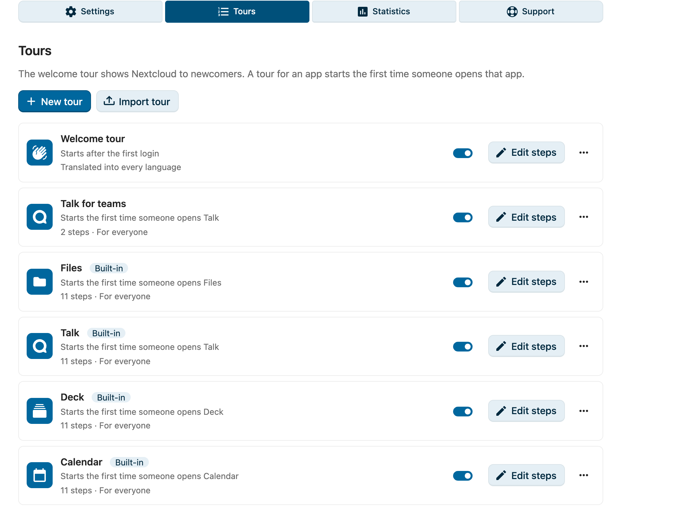

# Administrator Guide

This guide describes day-to-day administration of IntroVox. For installation, see the [Installation Guide](../deployment/installation.md).

## Overview

IntroVox shows people around Nextcloud with guided tours: the welcome tour after their first login, and short tours for apps and pages. As an administrator, you control:

- **Tours for everyone** — turn all tours on or off for everyone
- **Tours** — the welcome tour, the built-in tours for Files, Talk, Deck and Calendar, and tours of your own that start in an app, on another page, or anywhere ([Tours](tours.md))
- **Who gets a tour and when** — groups, everyone or new accounts only, a number of days after the first login, and dates
- **Per-language overrides** — optionally replace the auto-translated default copy with custom text for specific languages, or let AI translate it
- **Step management** — add, edit, delete, reorder, and enable/disable individual steps; images and videos; steps that go on with a click or a filled-in field
- **Group-based visibility** — restrict specific steps to certain user groups (role-based onboarding)
- **Sharing and showing again** — a link that starts a tour; giving a tour once more to everyone who saw it
- **Statistics** — per tour, how many people started, completed and skipped it, and how far people get
- **The checklist on the Dashboard** — a "Getting started" list of first things to do

## Accessing Administrator Settings

1. Click your **user avatar** in the top right
2. Select **Settings** (⚙️)
3. Scroll down the left sidebar to **Administration**
4. Click **IntroVox**

You're now on the IntroVox administration page.

## Admin Interface Layout

Four panes — **Settings**, **Tours**, **Statistics** and **Support** — sit
behind the row of buttons at the top of the page. One pane shows at a time.

The **Tours** pane lists the tours: the **Welcome tour**, which new users
get after their first login, the tours marked **Built-in** (Files, Talk,
Deck and Calendar, once their app is installed), and tours of your own that
start in an app, on another page, or anywhere. Each has an on/off switch,
**Edit steps**, and a ⋯ menu with **Preview**, **Copy link**,
**Export tour**, **Show again to everyone** and (not for the welcome tour
or a built-in tour) **Delete**. **New tour** makes a tour for an app, a
page, or anywhere; **Import tour** adds one from a file that **Export tour**
made, here or on another Nextcloud. See [Tours](tours.md).

The **Statistics** pane shows one tour at a time: started, completed,
skipped, and how far people get ([Statistics](tours.md#statistics)), with
the anonymous usage statistics below ([Telemetry](telemetry.md)). The
**Support** pane says what IntroVox is (**About IntroVox**: free and open
source, no paid features), links to the other VoxCloud apps (**Do you value
this app?**), and under **Need help?** has **Report an issue**, **Source
code**, **Show the admin tour again** and an address for **Questions?**.

The three sections below are what the **Settings** pane and a tour's step
editor hold. To open the step editor, click **Edit steps** on a tour;
**All tours** goes back to the list.

### 1. Global Settings

- **Tours for everyone** — master on/off switch for all tours ([Settings](settings.md))
- **Show Tours in the user menu** — puts **Tours** in everyone's user menu, above **Help**, leading to their tours in the personal settings
- A line with the number of languages that currently have an admin override
- **Checklist on the Dashboard** — **Show "Getting started" on the Dashboard**, its **Tasks**, **Your own tasks** and **Put it on every Dashboard** ([Checklist on the Dashboard](settings.md#checklist-on-the-dashboard))

### 2. Language Selector (step editor)

- Dropdown lists English plus every language that currently has an admin override
- **Add language override** — searchable picker over the full Nextcloud language list; switches the editor to that language seeded with the current default copy. No DB row is written until you save
- Switches the step list to the chosen language's override configuration

### 3. Step Management

- **Add step** — create new wizard steps
- **Edit / Delete** — modify or remove existing steps
- **Image or video** — an image, GIF or video above a step's text ([Image or video](managing-steps.md#image-or-video))
- **Pick element** — point at the element a step highlights instead of typing a CSS selector
- **Continue with** — **Next button**, **Click on the element** or **Filling in the field** ([Click to continue](managing-steps.md#click-to-continue), [Steps that wait for the user](managing-steps.md#steps-that-wait-for-the-user))
- **Preview tour / Test this step** — see the tour or a single step the way users get it
- **Drag handle**, or **Move step up / Move step down** — reorder steps, with or without a mouse
- **Enable/disable switch** — temporarily hide steps without deleting
- **Translate with AI / Write steps with AI** — only with a provider for the Nextcloud Assistant ([Write or translate steps with AI](tours.md#write-or-translate-steps-with-ai))
- **Export / Import** — the steps of one language as JSON ([Import/Export](import-export.md)); a whole tour goes with **Export tour** in the list
- **Reset** — delete the current language's override row; the next request serves the auto-translated defaults straight from Transifex
- **Tour settings** — the tour's name, main language, groups, who gets it and when

Every change is saved as you make it.

See [Managing Tour Steps](managing-steps.md) for details.

## End User Experience

### Automatic Start

While **Tours for everyone** is on:

- New users get the welcome tour automatically after their first login, in their Nextcloud language
- The welcome tour starts on the first page they open, whichever that is (not on IntroVox's own admin page)
- Users can close a tour anytime with **✕** or Esc, or with **Skip and don't show again** on the welcome tour's first step
- A tour for an app that you switched on starts the first time a user opens that app, once per user; a tour that starts anywhere, on whichever page they open next. It never starts on top of the welcome tour: a user who hasn't had the welcome tour gets that first, and the other tour on a later visit. Days and dates can hold it back further, see [When a tour starts](tours.md#when-a-tour-starts)

IntroVox detects the user's Nextcloud language and serves the matching translated default copy, or — if you authored one — the admin override for that language. When neither a Transifex translation nor an admin override exists for the user's language, the tour falls back to English defaults.

Users who switch off **Start tours by themselves** in their personal settings get no tour automatically, neither the welcome tour nor tours for apps.

### Manual Start

Users run the welcome tour again with **Personal Settings → IntroVox → Restart tour now**: it opens their start page and the tour starts there. The other tours are listed there under **Tours**, each with a **Start** button, and **Tours** in the user menu leads there. Starting a tour by hand works even when **Start tours by themselves** is off. A link from **Copy link** starts a tour the same way ([Share a tour with a link](tours.md#share-a-tour-with-a-link)).

### Behavior When Tours Are Off

If you switch off **Tours for everyone**:

- Users do **not** get any tour automatically, neither the welcome tour nor tours for apps
- In their personal settings they see: "The introduction tour is currently disabled by your administrator."
- They cannot start a tour manually

## Showing a Tour Again

**Show again to everyone** in a tour's ⋯ menu gives that tour again to everyone who saw it. For the **Welcome tour** that includes:

- Users who already completed it with **Done**
- Users who skipped it with **Skip and don't show again**

Use this when:

- A major Nextcloud upgrade adds features worth highlighting
- You significantly updated a tour's content
- An important company announcement needs broad visibility

> **Note:** Users who switched off **Start tours by themselves** in their personal settings keep that. They don't get the tour automatically, but can still start it from their personal settings.

## Next Steps

- [Settings reference](settings.md) — every admin option in detail
- [Tours](tours.md) — the welcome tour and tours for apps
- [Managing Tour Steps](managing-steps.md) — step CRUD and reordering
- [Group-Based Visibility](group-visibility.md) — role-based onboarding (v1.2.0+)
- [Import/Export](import-export.md) — share configurations
- [Best Practices](best-practices.md) — content guidelines
- [Telemetry](telemetry.md) — the anonymous usage statistics
- [Troubleshooting](troubleshooting.md) — common issues
- [FAQ](faq.md) — frequently asked questions
