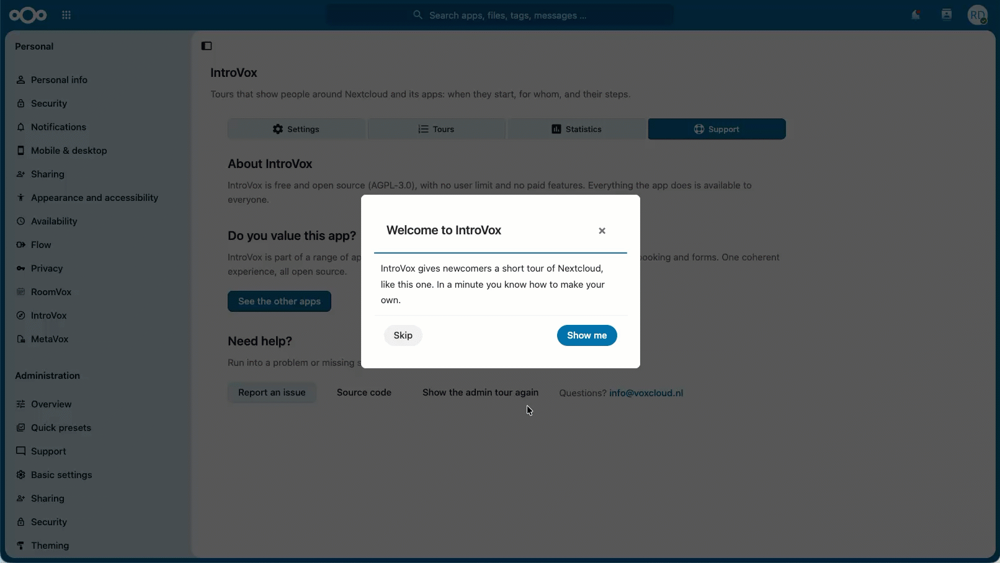
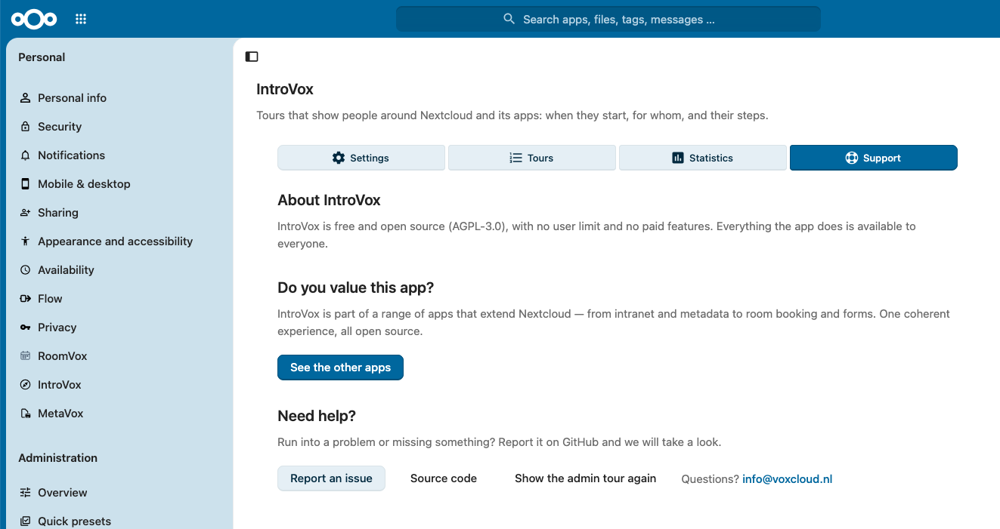

# Beheerdersgids

Deze gids beschrijft dagelijks beheer van IntroVox. Voor installatie, zie de [Installatie-gids](../deployment/installation.nl.md).

*De korte tour die elke beheerder krijgt bij het eerste bezoek aan de IntroVox-instellingen. **Show the admin tour again** onder **Ondersteuning** start hem opnieuw.*

## Overzicht

IntroVox laat mensen Nextcloud zien met geleide tours: de welkomsttour na hun eerste login, en korte tours voor apps en pagina's. Als beheerder bepaal jij:

- **Tours for everyone** — zet alle tours aan of uit voor iedereen
- **Tours** — de welkomsttour, de ingebouwde tours voor Bestanden, Talk, Deck en Agenda, en eigen tours die starten in een app, op een andere pagina, of overal ([Tours](tours.nl.md))
- **Wie een tour krijgt en wanneer** — groepen, iedereen of alleen nieuwe accounts, een aantal dagen na de eerste login, en datums
- **Taal-overrides** — vervang eventueel de automatisch vertaalde standaardtekst door eigen tekst voor bepaalde talen, of laat AI hem vertalen
- **Stap-beheer** — stappen toevoegen, bewerken, verwijderen, herordenen en in-/uitschakelen; afbeeldingen en video's; stappen die verdergaan met een klik of een ingevuld veld
- **Groep-gebaseerde zichtbaarheid** — beperk specifieke stappen tot bepaalde gebruikersgroepen (rol-gebaseerde onboarding)
- **Delen en opnieuw tonen** — een link die een tour start; een tour nog een keer geven aan iedereen die hem gezien heeft
- **Statistieken** — per tour hoeveel mensen hem startten, afmaakten en oversloegen, en hoe ver mensen komen
- **De checklist op het Dashboard** — een lijst "Aan de slag" (Getting started) met de eerste dingen om te doen

## Beheerder-instellingen openen

1. Klik op je **gebruikers-avatar** rechtsboven
2. Selecteer **Instellingen** (⚙️)
3. Scroll naar beneden in de linker-sidebar naar **Beheer**
4. Klik op **IntroVox**

Je bent nu op de IntroVox-beheerder-pagina.

## Indeling van de beheer-interface

Vier panelen — **Instellingen**, **Tours**, **Statistieken** en **Ondersteuning** (Settings, Tours, Statistics, Support) —
zitten achter de knoppenrij bovenaan de pagina. Er is steeds één paneel
zichtbaar.

Het paneel **Tours** toont de tours: de **Welcome tour**, die nieuwe
gebruikers na hun eerste login krijgen, de tours met het label **Ingebouwd**
(Bestanden, Talk, Deck en Agenda, zodra hun app geïnstalleerd is), en eigen
tours die in een app, op een andere pagina of overal starten. Elke tour
heeft een schakelaar, **Stappen bewerken** en een ⋯-menu met **Voorbeeld**,
**Link kopiëren**, **Tour exporteren**, **Show again to everyone** en (niet bij de
welkomsttour en de ingebouwde tours) **Verwijderen**. **Nieuwe tour** maakt een
tour voor een app, een pagina of overal; **Tour importeren** voegt er een toe
uit een bestand dat **Tour exporteren** maakte, hier of op een andere
Nextcloud. Zie [Tours](tours.nl.md).

Het paneel **Statistieken** toont één tour tegelijk: gestart, afgemaakt,
overgeslagen, en hoe ver mensen komen ([Statistieken](tours.nl.md#statistieken)),
met daaronder de anonieme gebruiksstatistieken ([Telemetrie](telemetry.nl.md)).
Het paneel **Ondersteuning** vertelt wat IntroVox is (**Over IntroVox**: gratis en
open source, geen betaalde functies), verwijst naar de andere VoxCloud-apps
(**Waardeer je deze app?**), en heeft onder **Hulp nodig?** de knoppen
**Meld een probleem**, **Broncode** en **Show the admin tour again**, met een
adres bij **Vragen?**.

De drie secties hieronder zijn wat het paneel **Instellingen** en de
stappen-editor van een tour bevatten. De stappen-editor open je met
**Stappen bewerken** bij een tour; **Alle tours** brengt je terug naar de lijst.

### 1. Globale instellingen

- **Tours for everyone** — hoofdschakelaar voor alle tours ([Instellingen](settings.nl.md))
- **Show Tours in the user menu** — zet **Tours** in het gebruikersmenu van iedereen, boven **Help**; het leidt naar hun tours in de persoonlijke instellingen
- Een regel met het aantal talen dat op dit moment een override van een beheerder heeft
- **Checklist op het Dashboard** — **Show "Getting started" on the Dashboard**, de **Taken**, **Your own tasks** en **Put it on every Dashboard** ([Checklist op het Dashboard](settings.nl.md#checklist-op-het-dashboard))

### 2. Taal-selector (stappen-editor)

- De dropdown toont Engels plus elke taal die op dit moment een override heeft
- **Taalspecifieke versie toevoegen** — doorzoekbare lijst met alle talen van Nextcloud; zet de editor op die taal, met de huidige standaardtekst als begin. Er wordt niets in de database gezet tot je opslaat
- Schakelt de stap-lijst naar de override van de gekozen taal

### 3. Stap-beheer

- **Stap toevoegen** — nieuwe wizard-stappen aanmaken
- **Bewerken / Verwijderen** — bestaande stappen wijzigen of verwijderen
- **Afbeelding of video** — een afbeelding, GIF of video boven de tekst van een stap ([Afbeelding of video](managing-steps.nl.md#afbeelding-of-video))
- **Element kiezen** — het element aanwijzen dat een stap markeert, in plaats van een CSS-selector te typen
- **Doorgaan met** — **Volgende knop**, **Klikken op het element** of **Het veld invullen** ([Klik om verder te gaan](managing-steps.nl.md#klik-om-verder-te-gaan), [Stappen die op de gebruiker wachten](managing-steps.nl.md#stappen-die-op-de-gebruiker-wachten))
- **Tour bekijken / Test this step** — de tour of één stap zien zoals gebruikers die krijgen
- **Sleep-handle**, of de pijlknoppen **Stap omhoog verplaatsen / Stap omlaag verplaatsen** — stappen herordenen, met of zonder muis
- **In-/uitschakelen-schakelaar** — stappen tijdelijk verbergen zonder ze te verwijderen
- **Translate with AI / Write steps with AI** — alleen met een provider voor de Nextcloud Assistant ([Stappen schrijven of vertalen met AI](tours.nl.md#stappen-schrijven-of-vertalen-met-ai))
- **Exporteren / Import** — de stappen van één taal als JSON ([Import/Export](import-export.nl.md)); een hele tour gaat met **Tour exporteren** in de lijst
- **Herstellen** — verwijdert de override van de huidige taal; daarna krijgen gebruikers weer de automatisch vertaalde standaardstappen van Transifex
- **Tour settings** — de naam, hoofdtaal, groepen, wie hem krijgt en wanneer

Elke wijziging wordt direct opgeslagen.

Zie [Tourstappen beheren](managing-steps.nl.md) voor details.

## Eindgebruiker-ervaring

### Automatische start

Zolang **Tours for everyone** aan staat:

- Nieuwe gebruikers krijgen de welkomsttour automatisch na hun eerste login, in hun Nextcloud-taal
- De welkomsttour start op de eerste pagina die ze openen, welke dat ook is (niet op de beheerpagina van IntroVox zelf)
- Gebruikers kunnen een tour op elk moment sluiten met **✕** of Esc, of met **Overslaan en niet meer tonen** op de eerste stap van de welkomsttour
- Een tour voor een app die je hebt aangezet, start de eerste keer dat een gebruiker die app opent, één keer per gebruiker; een tour die overal start, op de eerstvolgende pagina die hij opent. Hij start nooit bovenop de welkomsttour: wie de welkomsttour nog niet had, krijgt die eerst, en de andere tour bij een later bezoek. Dagen en datums kunnen hem nog langer tegenhouden, zie [Wanneer een tour start](tours.nl.md#wanneer-een-tour-start)

IntroVox detecteert de Nextcloud-taal van de gebruiker en toont de vertaalde standaardtekst, of — als je die hebt geschreven — de override voor die taal. Is er voor die taal geen vertaling op Transifex en geen override, dan krijgt de gebruiker de Engelse standaardtekst.

Gebruikers die **Start tours by themselves** in hun persoonlijke instellingen uitzetten, krijgen geen enkele tour automatisch, de welkomsttour niet en de tours voor apps ook niet.

### Handmatige start

Gebruikers starten de welkomsttour opnieuw met **Persoonlijke instellingen → IntroVox → Tour nu herstarten**: dat opent hun startpagina en de tour start daar. Daar staan onder **Tours** ook de andere tours, elk met een knop **Start**, en **Tours** in het gebruikersmenu leidt daarheen. Zelf een tour starten werkt ook als **Start tours by themselves** uit staat. Een link van **Link kopiëren** start een tour op dezelfde manier ([Een tour delen met een link](tours.nl.md#een-tour-delen-met-een-link)).

### Gedrag wanneer de tours uit staan

Als je **Tours for everyone** uitzet:

- Gebruikers krijgen **geen** tour automatisch, de welkomsttour niet en de tours voor apps ook niet
- In hun persoonlijke instellingen zien ze: "De introductietour is momenteel uitgeschakeld door uw beheerder."
- Ze kunnen zelf geen tour starten

## Een tour opnieuw tonen

**Show again to everyone** in het ⋯-menu van een tour geeft die tour opnieuw aan iedereen die hem gezien heeft. Bij de **Welcome tour** zijn dat ook:

- Gebruikers die hem al hebben afgemaakt met **Klaar**
- Gebruikers die hem hebben overgeslagen met **Overslaan en niet meer tonen**

Gebruik dit wanneer:

- Een grote Nextcloud-upgrade features toevoegt die het waard zijn om uit te lichten
- Je de inhoud van een tour flink hebt aangepast
- Een belangrijke bedrijfs-aankondiging brede zichtbaarheid nodig heeft

> **Let op:** gebruikers die **Start tours by themselves** in hun persoonlijke instellingen hebben uitgezet, houden dat. Ze krijgen de tour niet automatisch, maar kunnen hem wel zelf starten via hun persoonlijke instellingen.

## Volgende stappen

- [Instellingen-referentie](settings.nl.md) — elke admin-optie in detail
- [Tours](tours.nl.md) — de welkomsttour en tours voor apps
- [Tourstappen beheren](managing-steps.nl.md) — stap-CRUD en herordenen
- [Groep-gebaseerde zichtbaarheid](group-visibility.nl.md) — rol-gebaseerde onboarding (v1.2.0+)
- [Import/Export](import-export.nl.md) — configuraties delen
- [Best practices](best-practices.nl.md) — content-richtlijnen
- [Telemetrie](telemetry.nl.md) — de anonieme gebruiksstatistieken
- [Problemen oplossen](troubleshooting.nl.md) — veelvoorkomende issues
- [FAQ](faq.nl.md) — veelgestelde vragen
