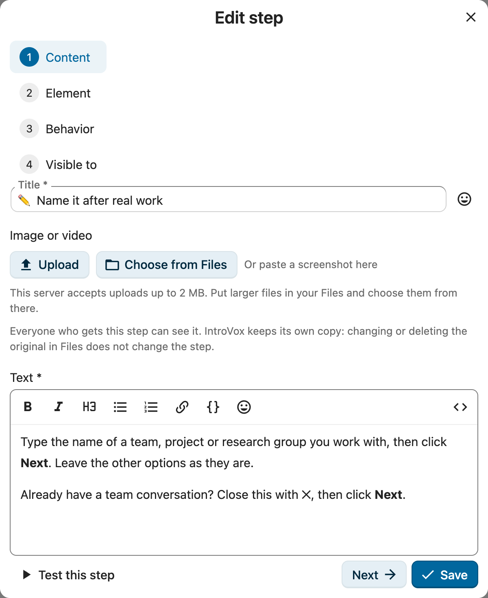
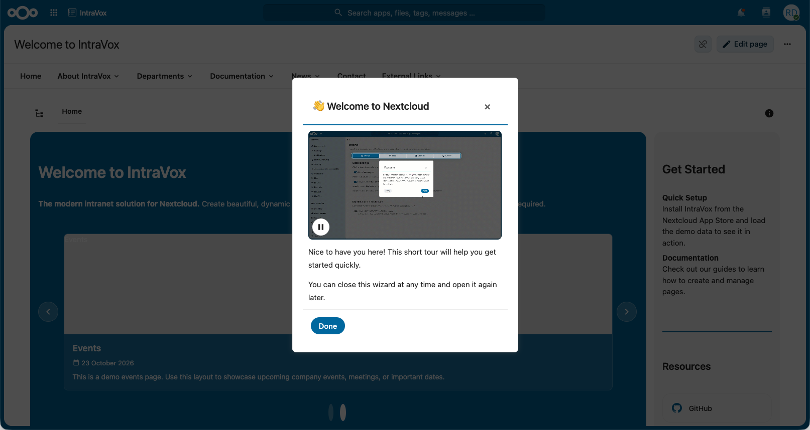
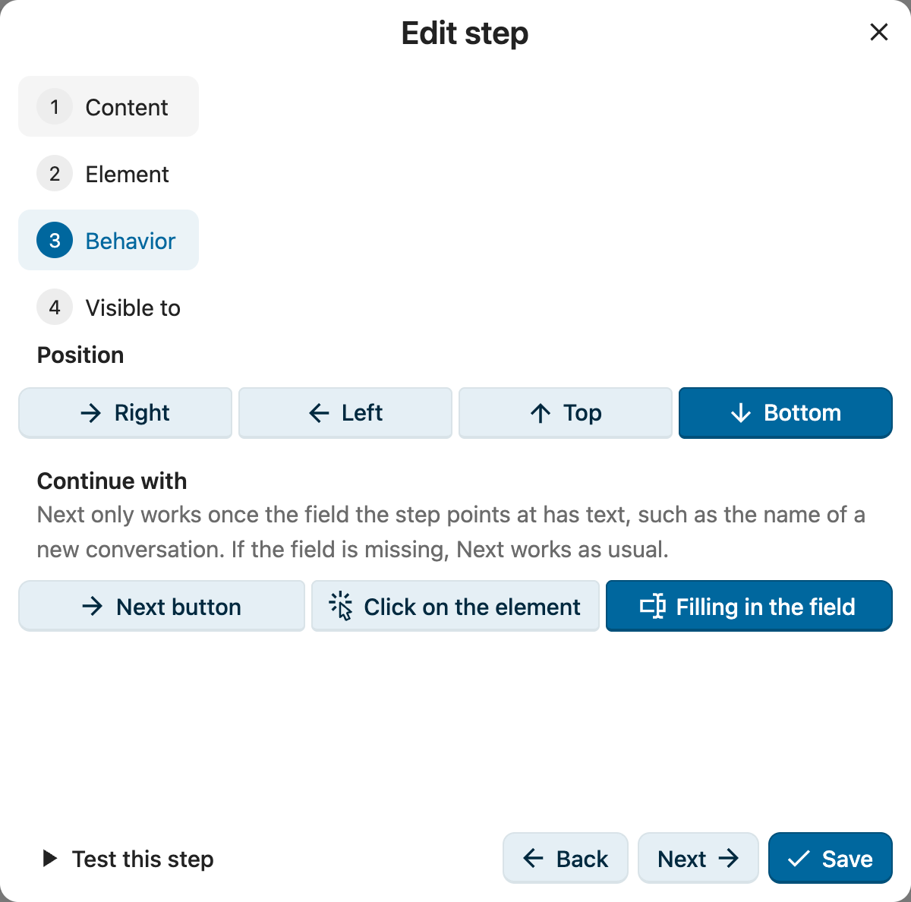
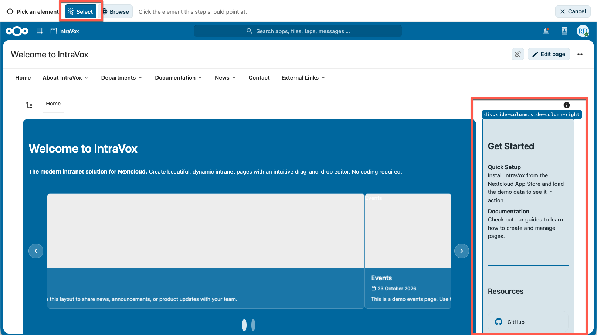
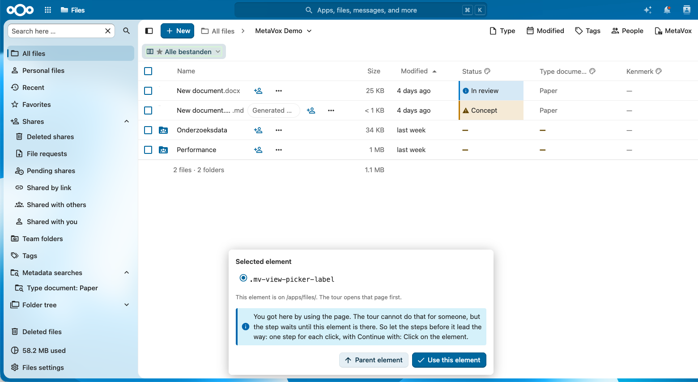

# Tourstappen beheren

Deze gids behandelt het werken met de stappen van een tour: toevoegen, bewerken, een element kiezen, bekijken, verwijderen, herordenen, in-/uitschakelen en resetten.

Elke wijziging wordt direct opgeslagen: een stap opslaan in de editor, verwijderen, herordenen en een stap aan- of uitzetten gaan meteen naar de server.

> Knoppen en velden staan hieronder met de Nederlandse naam die Nextcloud toont (zoals **Element kiezen**). Wat nog niet in het Nederlands vertaald is, staat met de Engelse naam (zoals **Test this step**); zo zie je het ook in beeld tot de vertaling er is.

## Overzicht van de stap-lijst

Stappen horen bij een tour. Open **Tours** en klik bij de tour op **Stappen bewerken**: de **Welcome tour** voor de tour die nieuwe gebruikers krijgen, of een tour voor een app (zie [Tours](tours.nl.md)). Na het selecteren van een taal in de dropdown **Taal** zie je de lijst stappen voor die taal. Elke rij toont:

| Onderdeel | Beschrijving |
|---|---|
| **Sleep-handle** | Slepen om te herordenen |
| **Stap omhoog verplaatsen / Stap omlaag verplaatsen** | Pijlknoppen: herordenen zonder muis |
| **Stap N** | Sequentieel stap-nummer |
| **Titel** | De stap-titel die gebruikers zien |
| **ID** | Unieke identifier (niet bewerkbaar na aanmaak) |
| **Schakelaar** | Stap in- of uitschakelen |
| **Bewerken** | De stap-editor openen |
| **Verwijderen** | De stap weghalen |

Onder elke rij: het element waar de stap naar wijst, de positie, het menu dat eerst geopend wordt (als dat er is) en wie de stap ziet.

## Nieuwe stap toevoegen

1. Klik op **Stap toevoegen** boven de lijst. Er opent een dialoog met links de pagina's **Inhoud**, **Element**, **Gedrag** en **Zichtbaar voor** (Gedrag pas als de stap een element heeft).
2. Vul elke pagina in en ga verder met **Volgende**
3. Klik op de laatste pagina op **Opslaan**. De stap is opgeslagen; sluit je de dialoog zonder op te slaan, dan verdwijnt de nieuwe stap weer.

**Test this step**, linksonder in de dialoog, toont de stap zoals hij nu is, inclusief niet-opgeslagen wijzigingen.

### Formulier-velden



| Veld | Verplicht | Beschrijving | Voorbeeld |
|---|---|---|---|
| **Titel** | Ja | Stap-titel, platte tekst; de smileyknop ernaast voegt een emoji in | `👋 Welkom bij Nextcloud` |
| **Afbeelding of video** | Nee | Eén afbeelding, GIF of video boven de tekst; zie [Afbeelding of video](#afbeelding-of-video) hieronder | Een screenshot van het appmenu |
| **Tekst** | Ja | Stap-body, geschreven met opmaak; zie [Tekst](#tekst) hieronder | Leuk dat je er bent! |
| **Pagina** | Nee | De app waar de stap bij hoort; de tour opent die eerst. Leeg = elke pagina. **Element kiezen** vult dit in. Zie [Tours over meerdere apps](../features/guided-tours.nl.md#tours-over-meerdere-apps). | `/apps/spreed/` |
| **Koppelen aan element (CSS-selector)** | Nee | Element om te markeren; leeg = gecentreerde stap. Vul het met **Element kiezen**. | `a[href*="/apps/files/"]` |
| **Eerst openen (CSS-selector)** | Nee | Voor een element in een menu: de knop waarop de tour eerst klikt om dat menu te openen. **Element kiezen** vult dit in. | `.app-menu__waffle` |
| **Positie** | Als een element is ingesteld | Kant van het element waar de tooltip verschijnt | Rechts, Links, Boven, Onder |
| **Doorgaan met** | Als een element is ingesteld | **Volgende knop** (standaard); **Klikken op het element**: gebruikers klikken op het gemarkeerde element om verder te gaan; of **Het veld invullen**: **Volgende** werkt pas als het veld tekst heeft. Zie [Klik om verder te gaan](#klik-om-verder-te-gaan) | Klikken op het element |
| **Zichtbaar voor groepen** | Nee | Groepen die deze stap kunnen zien; leeg = alle gebruikers | `Administrators` |

Elke stap krijgt bij het aanmaken een uniek ID (zichtbaar in de lijst, niet te bewerken). Op de pagina **Element** staan element, pagina en menu samengevat naast **Element kiezen** en **Remove element** (terug naar een gecentreerde stap); open **Handmatig bewerken** om ze zelf aan te passen.

### Tekst

Het veld **Tekst** is een opmaakeditor en toont de tekst zoals de tour dat doet: vet, cursief, een tussenkop, opsommingen en genummerde lijsten, links en code, via de werkbalk of met de gewone sneltoetsen (Ctrl+B, Ctrl+I). De smileyknop voegt een emoji in, net als naast de titel. Voor een link selecteer je de woorden en klik je op de linkknop; links openen in een nieuw tabblad, zodat de tour blijft staan. Een adres als `nextcloud.com` wordt `https://nextcloud.com`, en een pad op deze Nextcloud zoals `/apps/files/` blijft een pad.

De knop `<>` rechts, **Bewerken als HTML**, toont de HTML zelf. HTML die gebruikers nooit zien, omdat de tour hem weghaalt (een `class`, een stijl, een afbeelding), laat de editor weg, en een regel onder het veld noemt hem. Een stap openen verandert hem niet; die HTML verdwijnt pas als je de tekst aanpast. De tekst wordt hoe dan ook als HTML opgeslagen, dus exporteren, importeren en de vertaalde standaardstappen werken als voorheen; zie [Customization](../features/customization.nl.md) voor de tags die de tour bewaart.

### Afbeelding of video

Een stap kan boven zijn tekst één afbeelding (PNG of JPEG), geanimeerde GIF of video (MP4 of WebM) tonen. Kies **Upload**, kies met **Kies uit Bestanden** een bestand uit je eigen Bestanden, of plak een screenshot op het blok.



- **Beschrijving (alt-tekst)** is verplicht: dat is wat mensen horen die de afbeelding niet zien. Zet **Decoratief, geen beschrijving nodig** alleen aan als de afbeelding niets toevoegt aan de tekst.
- **Grootte:** Klein, Volle breedte, of **Wide step**, die de stap ook breder maakt.
- **Video:** **With a play button** start nooit vanzelf; **Speelt af als een GIF** speelt geluidloos en herhaalt. Voeg ondertitels toe als WebVTT-bestand (`.vtt`) als er in de video gesproken wordt.
- Alles wat beweegt krijgt in de tour een pauzeknop, en staat stil voor wie "minder beweging" aan heeft staan.

IntroVox bewaart een eigen kopie van het bestand: het origineel in Bestanden wijzigen of verwijderen verandert de stap niet. Voordat IntroVox het bewaart, controleert het het echte bestandstype, weigert alles anders (zoals SVG) en haalt metadata zoals locatie en cameragegevens eruit. Iedereen die de stap krijgt kan het bestand zien, en verder niemand: gebruikers die de stap niet krijgen, of alleen in een uitgeschakelde stap, kunnen het niet laden.

Limieten: afbeeldingen 5 MB en 16 megapixel, GIF's 10 MB, video's 20 MB, ondertitels 512 KB; in totaal 250 MB en 500 bestanden. Een beheerder kan ze aanpassen met `occ config:app:set introvox` en de sleutels `media_limit_image`, `media_limit_gif`, `media_limit_video`, `media_limit_captions`, `media_max_pixels`, `media_quota_bytes` en `media_max_files` (bytes of aantallen).

Tips: maak screenshots in een testaccount (het jouwe toont je eigen bestanden, namen en avatar aan iedereen), ongeveer 900 pixels breed, en kies liever een korte MP4 dan een grote GIF.

### Klik om verder te gaan



Met **Doorgaan met: Klikken op het element** doen gebruikers wat de stap vraagt in plaats van erover te lezen: "Klik op Nieuw gesprek" gaat verder zodra ze erop klikken. De stap toont geen Volgende-knop en zegt "Klik op het gemarkeerde element om verder te gaan." Opent de klik iets op de pagina (een menu, een dialoog), dan volgt de volgende stap direct; opent hij een andere app, dan gaat de tour daar verder. Bij de laatste stap rondt de klik de tour af. Wordt het element niet gevonden, dan verschijnt alsnog een Volgende-knop, zodat niemand vastloopt.

Met **Doorgaan met: Het veld invullen** werkt **Volgende** pas als het veld waar de stap naar wijst tekst heeft, zoals de naam van een nieuw gesprek; de stap zegt "Vul het gemarkeerde veld in om verder te gaan." Een stap op een blok rond een veld kijkt naar het veld daarin. Is het veld er niet, of verdwijnt het (de dialoog sluit), dan werkt Volgende gewoon.

Het element waar een stap naar wijst krijgt een rand in de kleur van het thema en een knipperend pijltje vanaf de stap ernaartoe, ook in dialogen; voor wie minder beweging wil, staan ze stil.

### Stappen die op de gebruiker wachten

Sommige elementen bestaan pas als de gebruiker iets gedaan heeft: de deelnemers van een gesprek dat hij aanmaakt, het delen van een bestand waarvan hij de details opent, een kaart op een bord. Dat kan een tour niet voor hem doen, maar hij kan wel de weg wijzen: één stap per klik, elk met **Doorgaan met: Klikken op het element**, en dan de stap over het element. In Talk bijvoorbeeld: "Klik op Nieuw gesprek" → "Geef het een naam" → "Klik op Gesprek aanmaken" → "Voeg hier mensen toe".

Een stap waarvan het element er nog niet is, wacht erop: hij staat met zijn tekst rechtsonder opzij (linksonder zolang er een venster open is, zoals een om een map te kiezen, weg van de knoppen van het venster), laat de pagina bruikbaar, en schuift naar het element zodra het verschijnt, hoe lang de gebruiker er ook over doet. **Volgende** gaat ook zonder het element verder. Op een kleiner scherm maakt een stap naast een venster zich smaller, zodat hij het venster niet bedekt. Op een telefoon telt een element in de navigatie van een app als afwezig zolang die navigatie dicht is: de stap wacht tot de gebruiker haar opent.

Hoe lang een stap naar zijn element zoekt voordat hij opzij gaat wachten: de eerste stap op een pagina tot 5 seconden, omdat apps als Talk hun pagina pas na het laden opbouwen; een stap na een klik 1 seconde, voor het menu of venster dat de klik opent; een stap na **Volgende** of **Terug** 0,4 seconde.

Zo'n tour bouw je met **Element kiezen** in de modus **Bladeren**: klik op de pagina wat nodig is, houd dan Shift ingedrukt en klik op het element. De kiezer meldt dan dat de stap erop wacht.

### CSS-selector-voorbeelden

```css
/* Link naar de app Bestanden — meerdere fallbacks voor betere detectie */
[data-id="files"], #appmenu li[data-id="files"], a[href*="/apps/files"]

/* Zoek-balk — taal-onafhankelijke selectors (aanbevolen) */
.unified-search__trigger, .header-menu__trigger

/* Agenda-app */
[data-id="calendar"], a[href*="/apps/calendar"]

/* Gebruikers-menu */
#user-menu

/* Gecentreerde stap (laat leeg) */
```

**Tips voor betrouwbare selectors:**

- **Vermijd taal-specifieke attributen** zoals `aria-label="Unified search"` — die breken in andere talen. Gebruik CSS-classes zoals `.unified-search__trigger`.
- **Gebruik meerdere fallbacks** gescheiden door komma's. Default-stappen gebruiken dit patroon (bv. `[data-id="files"], a[href*="/apps/files"]`) om Nextcloud-UI-wijzigingen te overleven. De tour probeert ze in de volgorde waarin je ze schreef: de stap wijst naar de eerste die een zichtbaar element vindt, waar de andere ook op de pagina staan, dus zet de selector die je het liefst hebt vooraan.
- **Aanwijzen in plaats van typen**: zie [Element kiezen](#element-kiezen) hieronder.
- **Met de hand**: open DevTools (F12), klik op "Inspect element", klik dan op het target om classes en attributen te zien. Test elke selector apart met `document.querySelector('je-selector')` in de console; dat zou het element moeten teruggeven. Test zo geen hele komma-gescheiden lijst: de browser geeft dan de match die het eerst in de pagina staat, en dat hoeft niet de selector te zijn die de tour kiest.

### Element kiezen



In plaats van een selector op te zoeken in DevTools klik je op **Element kiezen** naast het element-veld. Nextcloud opent schermvullend binnen de instellingenpagina:

1. In de stand **Selecteren** beweeg je over de pagina; het element onder de muis krijgt een kader. Klik om het te kiezen. Klikken bereiken de pagina niet, dus links en knoppen doen niets.
2. Zoek je iets dat pas na een klik verschijnt, zoals een item in een menu? Schakel naar **Bladeren** en gebruik de pagina zoals altijd: open het menu, of ga naar een andere app. Om iets in een open menu te kiezen, **houd je Shift ingedrukt en klik je erop**. Het menu blijft open, en de picker onthoudt welke knop het opende.
3. Het paneel toont één of meer selectors die precies dit element vinden. Kies er een, of gebruik **Bovenliggend element** als je op een icoon klikte maar het omliggende vlak bedoelde.
4. Klik op **Use this element**. De selector wordt ingevuld. Had de stap nog geen element, dan krijgt **Positie** een waarde die past bij waar het element staat (bijvoorbeeld Onder voor de header). Voor een element in een menu wordt **Eerst openen** ingevuld met de knop die het menu opent. Voor een element in een app, zoals Talk, wordt **Pagina** die app, zodat de tour hem vóór de stap opent; elementen in de Nextcloud-header werken op elke pagina en krijgen geen pagina.



De picker gebruikt alleen wat hetzelfde blijft tussen paginaladingen en talen: vaste id's, `data-*`-attributen, link-doelen en component-classes. Gegenereerde id's, toestands-classes zoals `--active` en vertaalde attributen zoals `aria-label` slaat hij over. Het paneel kan deze meldingen tonen:

- "This element is inside a menu. During the tour, the menu is opened first with: …": de tour klikt vóór de stap op de genoemde knop, zodat het element er is als de stap verschijnt.
- "This element is inside a menu or pop-up that only exists while it is open." (waarschuwing): de picker kon niet zien welke knop het menu opent, dus tijdens de tour wacht de stap opzij tot de gebruiker het menu opent. Open het menu in de stand **Bladeren** en Shift-klik het element, of kies de knop die het menu opent.
- "You got here by using the page.": de stap wacht op zijn element; zie [Stappen die op de gebruiker wachten](#stappen-die-op-de-gebruiker-wachten).
- "This selector depends on where the element sits in the page…" (waarschuwing): niets vasts identificeert het element, dus de selector beschrijft waar het in de pagina staat (`nth-of-type`). Dat kan na een Nextcloud-update stukgaan.

Meldt de picker "Nextcloud kon hier niet worden getoond", controleer dan je verbinding en open hem opnieuw. Blijft het gebeuren, dan verbiedt je server waarschijnlijk het tonen van Nextcloud in een frame (`X-Frame-Options: DENY`); vul de selector dan met de hand in.

### Positie-gids

| Positie | Geschikt voor |
|---|---|
| Rechts | Linker-sidebar-elementen (Bestanden, Agenda) |
| Links | Rechter-sidebar-elementen (gebruikers-menu) |
| Boven | Onder-navigatie |
| Onder | Boven-navigatie (header, zoeken) |

## Bekijken

Je hoeft niet als testgebruiker in te loggen om te zien wat je hebt ingesteld.

- **Tour bekijken** (boven de lijst) opent Nextcloud schermvullend en speelt de tour af voor de geselecteerde taal, zoals gebruikers hem krijgen: uitgeschakelde stappen worden overgeslagen. Met **Bekijken als** zie je wat leden van één groep krijgen, volgens [Zichtbaar voor groepen](group-visibility.nl.md). **Restart** speelt hem opnieuw af, ook nadat je in het voorbeeld naar een andere app bent gegaan.
- **Test this step** (in de stap-editor) toont alleen die stap, inclusief wijzigingen die je nog niet hebt opgeslagen. Zo zie je of het kader op het juiste element valt en of de positie klopt.

Beide volgen stappen naar andere apps, net als de echte tour.

Een voorbeeld laat geen sporen na: het telt niet mee in de statistieken, en je eigen tour wordt er niet door als gezien of uitgeschakeld gemarkeerd.

## Stap bewerken

1. Klik op **Bewerken** naast de stap; dezelfde dialoog opent
2. Wijzig wat nodig is op elke pagina; klik links op een pagina om er direct heen te gaan
3. Klik op **Opslaan**, bij bewerken op elke pagina beschikbaar, of sluit de dialoog om je wijzigingen te verwerpen

Verlaat je de pagina terwijl de dialoog niet-opgeslagen wijzigingen heeft, dan vraagt de browser eerst om bevestiging.

Wijzig je het element van een van de default-stappen (Bestanden & apps, Zoeken, Je account & instellingen), dan gebruikt de tour vanaf dan jouw element in plaats van het ingebouwde.

## Stap verwijderen

1. Klik op **Verwijderen**
2. Bevestig in het dialoog

De stap wordt direct verwijderd.

> **Let op:** overweeg om de stap [uit te schakelen](#stap-aan-uitschakelen) in plaats van te verwijderen als je hem later misschien terug wilt.

## Stappen herordenen

In beide gevallen wordt de nieuwe volgorde direct opgeslagen.

**Met de muis**

1. Klik en houd de sleep-handle links van een stap vast
2. Sleep naar de nieuwe positie
3. Laat los om te plaatsen

**Met het toetsenbord**

1. Tab naar de knop **Stap omhoog verplaatsen** of **Stap omlaag verplaatsen** (de pijltjes naast de sleep-handle)
2. Druk op Enter of spatie

Aan de uiteinden van de lijst is de knop uitgeschakeld: de eerste stap heeft
geen **Stap omhoog verplaatsen**, de laatste geen **Stap omlaag verplaatsen**. Slepen werkt alleen met een
aanwijzer — daarom bestaan deze knoppen: ze zijn de enige manier om te
herordenen met het toetsenbord of met een schermlezer.

De stap-volgorde wordt bijgehouden op stap-**ID** (niet op positie), zodat in-/uitschakelen van stappen na herordenen correct werkt.

## Stap aan-/uitschakelen

Elke stap heeft een schakelaar:

- **Aan** — getoond aan gebruikers
- **Uit** — verborgen (grijs gemaakt, met doorstreping)

Uitgeschakelde stappen blijven in je configuratie. Gebruik dit voor:

- Stappen tijdelijk verbergen zonder ze te verwijderen
- Seizoens- of conditionele content
- Verschillende tour-configuraties testen

## Reset naar default

De knop **Herstellen** herstelt fabrieks-defaults voor **alleen de geselecteerde taal**.

1. Selecteer de taal om te resetten
2. Klik op **Herstellen**
3. Bevestig in het dialoog

**Waarschuwingen:**

- **Kan niet ongedaan worden gemaakt** — exporteer eerst als je een back-up wilt
- **Alleen de geselecteerde taal** wordt gereset; andere talen blijven onveranderd
- Alle custom-stappen voor die taal worden verwijderd

De default-stappen van de welkomsttour zijn: Welkom bij Nextcloud → Bestanden & apps → Zoeken → Je account & instellingen → Aan de slag → Belangrijke functies → Handige tips → Klaar!

## Opslaan

Wijzigingen worden opgeslagen terwijl je ze maakt, met een korte bevestiging "Stappen opgeslagen" bij bewerken en verwijderen. Mislukt het opslaan (bijvoorbeeld doordat de verbinding wegviel), dan krijg je een foutmelding en verschijnt boven de lijst de knop **Wijzigingen opslaan** om het opnieuw te proberen. Je wijziging blijft in de lijst staan tot hij is opgeslagen.

## Groep-gebaseerde zichtbaarheid

Het veld **Zichtbaar voor groepen** in de stap-editor beperkt een stap tot specifieke Nextcloud-groepen. Leeg = zichtbaar voor alle gebruikers. Zie [Groep-gebaseerde zichtbaarheid](group-visibility.nl.md) voor de volledige gids.

## Zie ook

- [Groep-gebaseerde zichtbaarheid](group-visibility.nl.md) — stappen beperken tot gebruikersgroepen
- [Import/Export](import-export.nl.md) — configuraties delen
- [Customization](../features/customization.nl.md) — HTML in stap-content, CSS-selectors
- [Best practices](best-practices.nl.md) — content-richtlijnen
