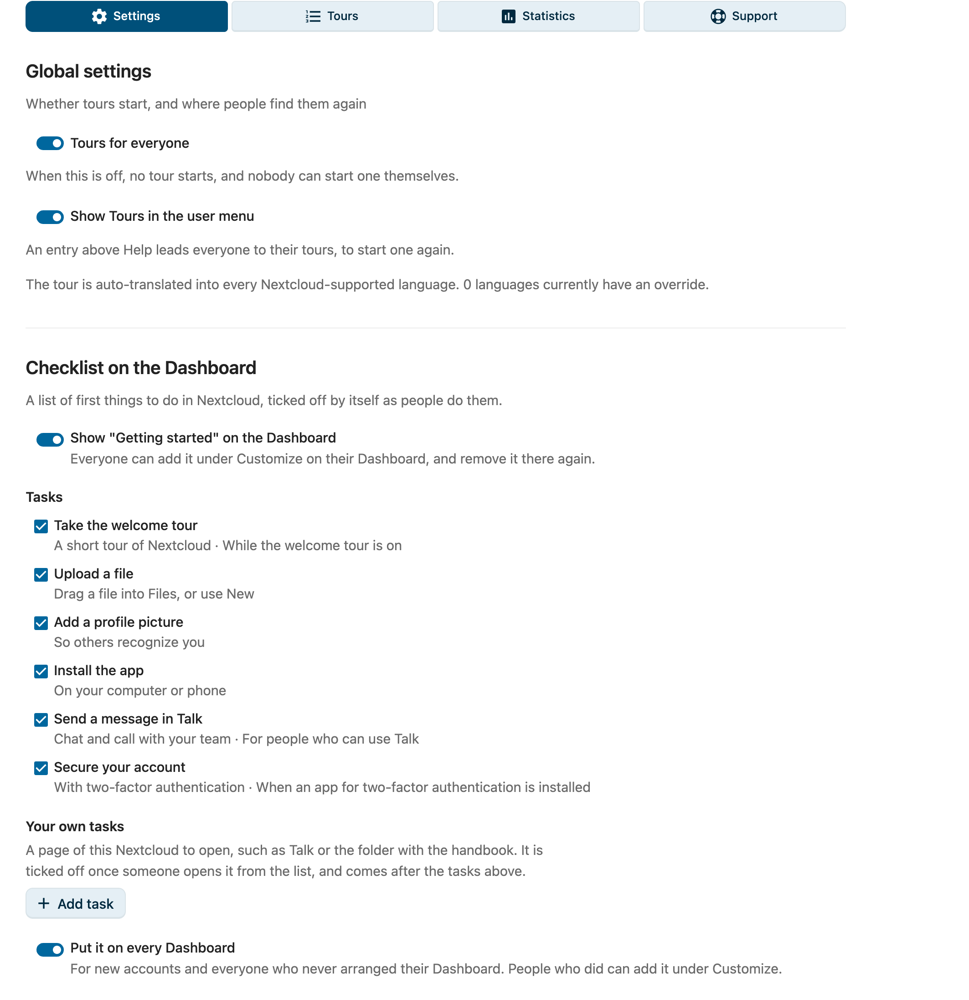
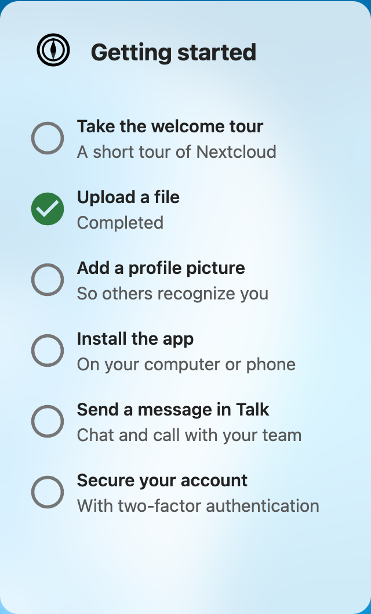

# Beheerder-instellingen-referentie

Referentie voor elke optie in **Instellingen → Beheer → IntroVox**.

## Beheerderstour

De eerste keer dat een beheerder de instellingen van IntroVox opent, start een korte tour door de pagina, in dezelfde stijl als de tour die gebruikers krijgen: de vier onderdelen, de welkomsttour en tours voor apps, talen, hoe je in vier stappen een stap maakt, het voorbeeld en de schakelaar die de tour voor iedereen aanzet, met aan het eind een link naar deze handleiding. Iedere beheerder ziet hem één keer. **Show the admin tour again** onder **Support** start hem opnieuw.

Op een installatie waar nog niemand het gevraagd is, eindigt de tour met de vraag of anonieme gebruiksstatistieken gedeeld mogen worden; zie [Telemetrie](telemetry.nl.md). Die vraag komt één keer per installatie. Zolang de instellingen van IntroVox open zijn, start de gebruikerstour daar niet; die start op de volgende pagina.

## Globale instellingen

### Tours for everyone

**Locatie:** bovenaan het paneel **Settings** onder **Global settings** (vóór tours per app heette deze schakelaar **Enable wizard for all users**)

**Functie:** hoofdschakelaar voor alle tours: de welkomsttour en de tours voor apps en pagina's.

| Staat | Gedrag |
|---|---|
| ✅ Aan | Tours staan aan. Nieuwe gebruikers krijgen de welkomsttour automatisch na hun eerste login, in hun Nextcloud-taal. Tours die je onder **Tours** hebt aangezet, starten de eerste keer dat iemand hun app of pagina opent, of op de volgende pagina bij een tour die overal start. Gebruikers kunnen tours zelf starten via persoonlijke instellingen. Staat aan na installeren. |
| ☐ Uit | Er start geen tour: de welkomsttour niet en een tour voor een app ook niet, en gebruikers kunnen er zelf ook geen starten. Gebruikers zien "The introduction tour is currently disabled by your administrator." (in hun eigen taal) |

**Opslag:** `appconfig`-key `wizard_enabled` (`'true'` / `'false'`); de key heeft zijn oude naam gehouden

**Use-case:** handig tijdens onderhoud of wanneer je de onboarding-ervaring tijdelijk wilt uitschakelen zonder je stap-configuratie te verliezen.

### Show Tours in the user menu

**Locatie:** onder de schakelaar **Tours for everyone**

**Functie:** zet **Tours** in het gebruikersmenu van iedereen (onder hun avatar), net boven **Help**. Het leidt naar **Persoonlijke instellingen → IntroVox**, waar gebruikers elke tour opnieuw starten. Alleen zichtbaar zolang **Tours for everyone** aan staat. Standaard aan; wordt direct opgeslagen.

**Opslag:** `appconfig`-sleutel `user_menu` (`'true'` / `'false'`)

### Taaldekking

**Locatie:** een regel met uitleg onder de schakelaar **Tours for everyone**

**Functie:** vertelt hoeveel talen op dit moment een override van een beheerder hebben. Talen hoef je niet aan te zetten; elke taal die Nextcloud ondersteunt is voor gebruikers automatisch beschikbaar via de standaardstappen die op Transifex vertaald worden (resource `nextcloud/introvox`). Overrides beheer je in de stappen-editor van een tour (**Tours** → **Edit steps**) — zie [Talenbeheer](language-management.nl.md).

## Checklist op het Dashboard

**Locatie:** onder **Global settings**

**Functie:** **Show "Getting started" on the Dashboard** biedt iedereen een lijstje met eerste dingen om te doen in Nextcloud, als widget op het Dashboard. Standaard uit. Elke taak linkt naar de plek waar je hem doet, en vinkt zichzelf af zodra de gebruiker hem gedaan heeft; niemand vinkt iets met de hand af. Is alles gedaan, dan meldt de lijst dat. Zoals elke widget voegen mensen hem toe en halen ze hem weg onder **Aanpassen** op hun Dashboard; ook de mobiele apps van Nextcloud tonen hem.

**Taken** (kies welke je wilt; minstens één):

| Taak | Gedaan als |
|---|---|
| Take the welcome tour | De gebruiker heeft de welkomsttour afgerond. Alleen zolang de welkomsttour aan staat |
| Upload a file | De gebruiker heeft een bestand naar de eigen bestanden geüpload, via de webpagina of een client. De bestanden waarmee een nieuw account begint, tellen niet |
| Add a profile picture | De gebruiker heeft een eigen foto ingesteld |
| Install the app | Een desktopclient of mobiele app van Nextcloud is bij het account ingelogd |
| Send a message in Talk | De gebruiker heeft een bericht in Talk geschreven. Alleen voor wie Talk kan gebruiken; de gesprekken waarmee Talk elk account begint, tellen niet |
| Secure your account | De gebruiker heeft een tweede factor aangezet (back-upcodes tellen niet). Alleen als er een app voor tweestapsverificatie is geïnstalleerd |

**Eigen taken:** **Add task** maakt een eigen taak, met een titel, een korte tekst en een pagina van deze Nextcloud, zoals `/apps/spreed/` voor Talk, `/apps/files/?dir=/Handboek` voor een map, of een volledig adres van deze Nextcloud. Hij wordt afgevinkt zodra iemand hem vanuit de lijst opent, en staat na de taken hierboven. Hoogstens 10; schrijf ze in de taal van je gebruikers, want ze worden niet vertaald. Een taak verwijderen vergeet ook wie hem geopend heeft.

**Put it on every Dashboard:** zet de lijst op het Dashboard van nieuwe gebruikers en van iedereen die zijn Dashboard nooit zelf heeft ingedeeld; wie dat wel deed, houdt zijn indeling en kan hem toevoegen onder **Aanpassen**. Dit wijzigt de standaardindeling van het Dashboard (app `dashboard`, sleutel `layout`); uitzetten haalt de lijst er weer uit.

**Opslag:** `appconfig`-sleutels `checklist_enabled` (`'true'` / `'false'`), `checklist_tasks` (JSON-lijst met taak-ids) en `checklist_custom` (de eigen taken); zie ook [Waar instellingen worden opgeslagen](#waar-instellingen-worden-opgeslagen)

## Tours

Het paneel **Tours** toont de **Welcome tour**, de tours met het label **Built-in** (Files, Talk, Deck en Calendar, zodra hun app geïnstalleerd is), en eigen tours die in een app, op een andere pagina of overal starten. Elke tour heeft een schakelaar, **Edit steps** en een ⋯-menu met **Preview**, **Copy link**, **Export tour**, **Show again to everyone** en (niet bij de welkomsttour en de ingebouwde tours) **Delete**. **New tour** maakt een tour voor een app, een pagina of overal; **Import tour** voegt er een toe uit een bestand, met **Upload a file** of **Choose from Files**. Zie [Tours](tours.nl.md).

### Show again to everyone

**Show again to everyone** in het ⋯-menu van een tour geeft die tour opnieuw aan iedereen die hem gezien heeft. Bij de **Welcome tour**:

- Verhoogt het de versie-teller van de welkomsttour (`wizard_version`)
- Wist het bij elke gebruiker de markering "welkomsttour klaar" (`wizard_disabled`), die **Done** of **Skip and don't show again** zet
- Start de welkomsttour opnieuw, op de volgende pagina die ze openen, voor iedereen die hem gezien heeft

Bij elke andere tour verhoogt het de versie van die tour, zodat hij nog een keer start voor iedereen die een oudere versie zag.

> **Let op:** gebruikers die **Start tours by themselves** in hun persoonlijke instellingen hebben uitgezet, houden dat. Bij hen start de tour niet vanzelf; ze kunnen hem wel zelf starten via hun persoonlijke instellingen.

## Override-kiezer (in de stappen-editor van een tour)

### Taal selecteren om te bewerken

**Locatie:** bovenaan de stappen-editor van een tour: open **Tours** en klik bij de tour op **Edit steps** (de **Welcome tour** voor de tour die nieuwe gebruikers krijgen). **All tours** brengt je terug naar de lijst.

**Functie:** kiest welke taal-override je bewerkt. De stap-lijst onder de dropdown herlaadt met de override van die taal (of de automatisch vertaalde standaardstappen als er nog geen override is).

**Gedrag:**

- De dropdown toont Engels plus elke taal die op dit moment een override heeft
- De knop **Add language override** opent een doorzoekbare lijst met alle talen van Nextcloud; er wordt niets in de database gezet tot je opslaat
- Wijzigingen gelden alleen voor de **geselecteerde taal**
- Als je van taal wisselt met niet-opgeslagen wijzigingen, krijg je een waarschuwing

Voor de hele werkwijze met overrides zie [Talenbeheer](language-management.nl.md).

## Stap-beheer

De stap-beheer-sectie, in dezelfde stappen-editor, is uitgewerkt in [Tourstappen beheren](managing-steps.nl.md). De beschikbare controls zijn:

| Control | Actie | Referentie |
|---|---|---|
| **Add step** | Maak een nieuwe wizard-stap | [Stappen beheren → Toevoegen](managing-steps.nl.md#nieuwe-stap-toevoegen) |
| **Preview tour** | Speel de tour af in een voorbeeld, eventueel als groep | [Stappen beheren → Bekijken](managing-steps.nl.md#bekijken) |
| **Edit** | Wijzig een bestaande stap | [Stappen beheren → Bewerken](managing-steps.nl.md#stap-bewerken) |
| **Image or video** | Een afbeelding, GIF of video boven de tekst van de stap | [Stappen beheren → Afbeelding of video](managing-steps.nl.md#afbeelding-of-video) |
| **Pick element** | Wijs het element aan dat een stap markeert | [Stappen beheren → Element kiezen](managing-steps.nl.md#element-kiezen) |
| **Continue with** | **Next button**, **Click on the element** of **Filling in the field** | [Stappen beheren → Klik om verder te gaan](managing-steps.nl.md#klik-om-verder-te-gaan) |
| **Test this step** | Toon één stap in een voorbeeld, inclusief niet-opgeslagen wijzigingen | [Stappen beheren → Bekijken](managing-steps.nl.md#bekijken) |
| **Delete** | Verwijder een stap | [Stappen beheren → Verwijderen](managing-steps.nl.md#stap-verwijderen) |
| Sleephandvat | Stappen herordenen | [Stappen beheren → Herordenen](managing-steps.nl.md#stappen-herordenen) |
| Schakelaar | Individuele stappen aan/uitschakelen | [Stappen beheren → Aan/uitschakelen](managing-steps.nl.md#stap-aan-uitschakelen) |
| **Translate with AI** | Vertaal de stappen van deze taal naar andere talen; alleen met een provider voor de Nextcloud Assistant | [Tours → AI](tours.nl.md#stappen-schrijven-of-vertalen-met-ai) |
| **Write steps with AI** | Schrijf nieuwe stappen op basis van een beschrijving; alleen met een provider voor de Nextcloud Assistant | [Tours → AI](tours.nl.md#stappen-schrijven-of-vertalen-met-ai) |
| **Export** | Download de stappen van deze taal als JSON | [Import/Export](import-export.nl.md#wizard-stappen-exporteren) |
| **Import** | Upload stappen vanuit JSON | [Import/Export](import-export.nl.md#wizard-stappen-importeren) |
| **Reset** | Verwijder de override van de huidige taal; daarna komen de automatisch vertaalde standaardstappen terug | [Stappen beheren → Reset](managing-steps.nl.md#reset-naar-default) |
| **Save changes** | Verschijnt alleen na een mislukte poging, om opnieuw op te slaan; verder wordt alles direct opgeslagen | [Stappen beheren → Opslaan](managing-steps.nl.md#opslaan) |
| **Tour settings** | De naam, hoofdtaal en groepen van de tour, **Who gets it** en wanneer hij vanzelf start | [Tours → Een tour maken](tours.nl.md#een-tour-voor-een-app-maken) |

## Waar instellingen worden opgeslagen

| Instelling | Backend-opslag |
|---|---|
| Tours for everyone | `appconfig` → `wizard_enabled` |
| Tours in het gebruikersmenu | `appconfig` → `user_menu` |
| Versie van de welkomsttour (**Show again to everyone**) | `appconfig` → `wizard_version` (integer) |
| Overrides per taal (welkomsttour) | `appconfig` → `wizard_steps_<lang>` (JSON-array, alleen als een beheerder een override heeft opgeslagen) |
| De instellingen van elke tour, met zijn schakelaar (bij een ingebouwde tour alleen wat je veranderde) | `appconfig` → `tours` (JSON-array) |
| Stappen van elke andere tour | `appconfig` → `tour_steps_<tour>_<lang>` (JSON-array; een ingebouwde tour heeft er geen tot je een taal aanpast) |
| Tellers van de welkomsttour | `appconfig` → `wizard_started_count`, `wizard_completed_count`, `wizard_skipped_count` (gaan mee met de anonieme gebruiksstatistieken, zie [Telemetrie](telemetry.nl.md)) |
| Welkomsttour klaar, per gebruiker | `preferences` → `introvox` / `wizard_disabled` (`'true'` na **Done** of **Skip and don't show again**) |
| Welkomsttour gestart, afgemaakt, overgeslagen, per gebruiker | `preferences` → `introvox` / `wizard_started`, `wizard_completed`, `wizard_skipped` (tijdstip, één keer gezet; `wizard_completed` vinkt ook **Take the welcome tour** in de checklist af) |
| Start tours by themselves, per gebruiker | `preferences` → `introvox` / `tours_disabled` (`'true'` = uitgezet) |
| Andere tours gezien, per gebruiker | `preferences` → `introvox` / `tour_<tour>_seen` (de versie van de tour toen hij het laatst startte) |
| Andere tours afgemaakt of overgeslagen, per gebruiker | `preferences` → `introvox` / `tour_<tour>_completed`, `tour_<tour>_skipped` (tijdstip, één keer gezet) |
| Hoe ver een tour kwam, per gebruiker | `preferences` → `introvox` / `tour_<tour>_reached` (de versie van de tour, en de stap en zijn plaats, van de laatste run die vanzelf startte; `tour_welcome_reached` voor de welkomsttour) |
| Beheerderstour gezien | `preferences` → `introvox` / `admin_intro_done` (per beheerder) |
| Telemetrievraag gesteld | `appconfig` → `telemetry_asked` (moment waarop hij voor het eerst getoond werd) |
| Telemetriekeuze | `appconfig` → `telemetry_enabled` (ontbreekt tot een beheerder kiest) |
| Checklist op het Dashboard | `appconfig` → `checklist_enabled`, `checklist_tasks` (JSON-lijst; ontbreekt = alle taken) |
| Checklist op elk Dashboard | `appconfig` → `dashboard` / `layout` (de eigen standaardindeling van het Dashboard) |
| Een bestand geüpload, per gebruiker (checklist) | `preferences` → `introvox` / `checklist_uploaded` (moment waarop het voor het eerst gevonden werd) |
| Eigen taken van de checklist | `appconfig` → `checklist_custom` (JSON-lijst: `id`, `title`, `text`, `page`) |
| Eigen taak geopend, per gebruiker | `preferences` → `introvox` / `checklist_<id>` (moment waarop hij vanuit de lijst geopend werd) |
| Afbeeldingen en video's in stappen | de app-datamap van IntroVox, `media` en `media-meta` |
| Verwijderde tours (de laatste tien) | de app-datamap van IntroVox, `backups` |

Een tour verwijderen verwijdert ook zijn `tour_<tour>_*`-sleutels bij elke gebruiker.

> Bij de update die tours per app brengt, krijgen gebruikers die de tour in hun persoonlijke instellingen bewust hadden uitgezet (ze waren aan de welkomsttour begonnen, hadden hem niet afgemaakt of overgeslagen, en hadden **Permanently disable the introduction tour** aan) eenmalig **Start tours by themselves** uitgezet. Wie de welkomsttour heeft afgemaakt of overgeslagen, blijft tours voor apps krijgen.

> Installaties die van 1.6.x komen, kunnen nog een oude `enabled_languages`-rij in appconfig hebben. De code van 1.7.0 negeert die; hij blijft staan zodat terugzetten naar een oudere versie veilig is, en je kunt hem weghalen met `occ config:app:delete introvox enabled_languages`.

Zie [Backend-architectuur](../architecture/backend-architecture.nl.md) voor het volledige opslag-model.
