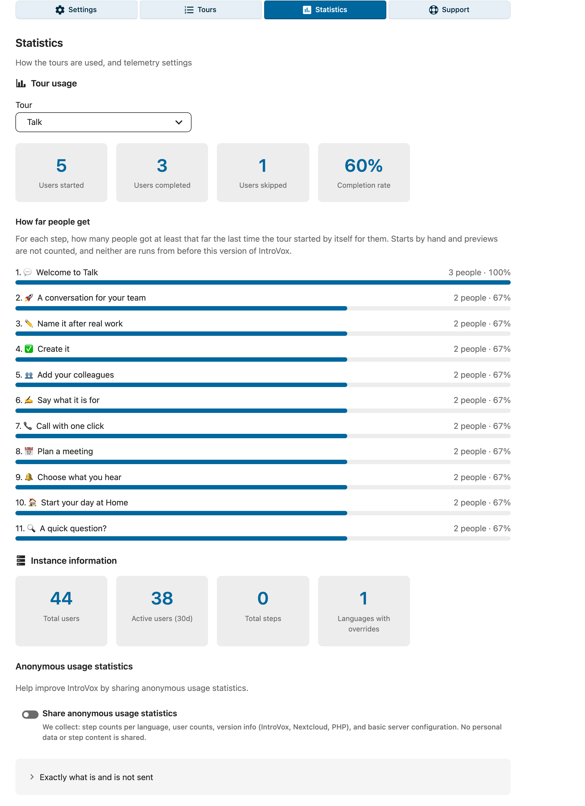

# Telemetry

IntroVox includes optional, anonymous usage reporting to help improve the application. The first time an admin opens IntroVox's settings, the [admin tour](settings.md#admin-tour) ends with the question whether to share it, with the list below. Nothing is sent before an admin has been asked. After that it is on unless an admin chose **Do not share**, and it can be switched off at any time.



The full list of what is and is not sent sits behind **Exactly what is and is
not sent** at the bottom of the pane.

## What Data Is Collected

IntroVox sends the following anonymous data periodically, exactly these fields (`TelemetryService::collectData()`):

| Data | Field | Description |
|------|-------|-------------|
| Instance hash | `instanceHash` | SHA-256 hash of the instance URL (`overwrite.cli.url`, else the first trusted domain). The URL itself is not sent |
| Total users | `totalUsers` | Number of accounts |
| Active users (30d) | `activeUsers30d` | Accounts that logged in in the last 30 days |
| Disabled users | `disabledUsers` | Number of accounts that exist but are disabled; empty when they could not be counted |
| IntroVox version | `introvoxVersion` | Installed IntroVox version |
| Nextcloud version | `nextcloudVersion` | Server version for compatibility tracking |
| PHP version | `phpVersion` | Server PHP version |
| Steps per language | `totalSteps` | For each language in `languagesWithOverrides`: the number of steps of the welcome tour's override (numbers only; 0 for English without an override) |
| Languages with overrides | `languagesWithOverrides` | Languages with an override of the welcome tour, plus `en` always (e.g., `["en", "nl"]`) |
| Tours for everyone | `wizardEnabled` | Whether **Tours for everyone** is on |
| Welcome tour started | `wizardStartedCount` | How many people started the welcome tour; each person counts once |
| Welcome tour completed | `wizardCompletedCount` | How many people clicked **Done** on its last step; each person counts once |
| Welcome tour skipped | `wizardSkippedCount` | How many people clicked **Skip and don't show again**; each person counts once |
| Users who started | `usersStartedWizard` | Distinct accounts that ever started the welcome tour |
| Users who completed | `usersCompletedWizard` | Distinct accounts that ever completed it with **Done** (skips not included) |
| Server region | `serverRegion` | From Nextcloud's `default_phone_region` setting |
| Default language | `defaultLanguage` | Nextcloud default language code |
| Default timezone | `defaultTimezone` | Nextcloud's `default_timezone`, else PHP's timezone, else UTC |
| Database type | `databaseType` | Nextcloud's `dbtype`, such as `mysql`, `pgsql` or `sqlite` |
| Total groups | `totalGroups` | Number of Nextcloud groups on the instance |
| Group visibility used | `groupVisibilityUsed` | Whether any step of the welcome tour's overrides is limited to groups (boolean) |
| OS family | `osFamily` | PHP's `PHP_OS_FAMILY`, such as Linux |
| Web server | `webServer` | Apache, nginx, or the name the server software gives |
| Docker | `isDocker` | Whether the server runs inside a Docker container (boolean) |
| License key | `licenseKey` | The IntroVox license key, when one is stored; empty otherwise (the app has had no field for it since 1.7.7). Sent so the license server can verify the Enterprise claim below — the booleans alone could otherwise be spoofed |
| Enterprise subscription | `hasValidSubscription` | Whether this Nextcloud has a valid Enterprise subscription (`IRegistry::delegateHasValidSubscription()`). `false` for Community and on any error |
| Extended Support | `hasExtendedSupport` | Whether that subscription also has the Extended Support add-on (`IRegistry::delegateHasExtendedSupport()`). `false` for Community and on any error |

## What Is NOT Collected

- No usernames, email addresses, or personal data
- No step content, titles, or descriptions
- No IP addresses or hostnames
- No URLs or domain names (only the instance-hash)
- No passwords or API tokens
- No per-user behavior — only aggregate counts
- Nothing about tours for apps or pages, and nothing of the per-tour statistics (**How far people get**): those stay on your server, on the [Statistics](tours.md#statistics) pane

## Where Data Is Sent

Telemetry is sent to `https://licenses.voxcloud.nl/api/telemetry/introvox`.

The endpoint is administrator-configurable via the `telemetry_url` app-config key, in case you want to point it at a self-hosted collector or block transmission via a fake URL.

## How to Disable Telemetry

### Via Admin Panel

1. Go to **Settings → Administration → IntroVox**
2. Open the **Statistics** tab
3. Switch off **Share anonymous usage statistics**

### Via Command Line

```bash
sudo -u www-data php occ config:app:set introvox telemetry_enabled --value false
```

### Block at the Network Layer

If your firewall blocks outbound connections to `licenses.voxcloud.nl`, IntroVox silently fails the daily report — telemetry never reaches the collector and no user-visible errors occur.

## Manual Report

You can send a telemetry report immediately from the Statistics pane:

1. Go to **Settings → Administration → IntroVox**
2. Open the **Statistics** tab
3. Click **Send report now**, in the note below **Share anonymous usage statistics**

The button is only there while **Share anonymous usage statistics** is on.

The button shows clear feedback:

- **Success**: "Statistics sent", and **Last report sent** shows the new time
- **Error**: "Error sending statistics: …" with the server's reason (e.g., rate limit, connectivity issue)

## Wizard-Tracking Events

Aside from the periodic aggregate report, the wizard reports three real-time lifecycle events to the local `TelemetryService` (not to the external server directly):

| Event | Endpoint | When |
|---|---|---|
| `start` | `POST /apps/introvox/api/wizard/start` | User begins the tour |
| `complete` | `POST /apps/introvox/api/wizard/complete` | User clicks **Done** on the last step |
| `skip` | `POST /apps/introvox/api/wizard/skip` | User clicks **Skip and don't show again** |

These update the per-user `markUserStarted/Completed/Skipped` timestamps in `oc_preferences` and feed into the aggregate counts in the next telemetry report. No content from the tour is included.

## Technical Details

- Telemetry runs as a Nextcloud background job (`TelemetryJob`)
- Reports are sent daily; failures are silently retried on the next interval
- Timeout: 15 seconds per request
- The instance hash is the SHA-256 of the instance URL, lower-cased and without a trailing slash, the same hash the license server knows the instance by; the URL itself never leaves the server
- No data is sent when telemetry is disabled and no external connections are made

## See Also

- [Settings](settings.md) — Admin panel overview
- [FAQ](faq.md) — Does the app collect telemetry?
- [Backend Architecture](../architecture/backend-architecture.md) — TelemetryService internals
