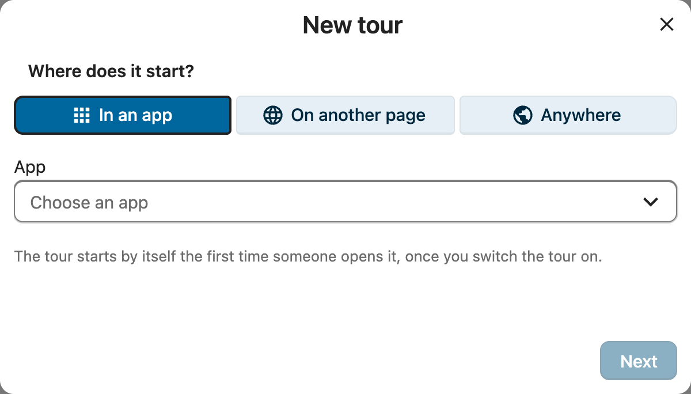

# Tours

Besides the welcome tour, IntroVox can show a short tour the first time someone opens an app, such as Talk or Deck, or another page of Nextcloud, or on whichever page they open next, for a tip after a few days. Each tour has its own steps, languages, audience and timing.

All tours are under **Settings → Administration → IntroVox → Tours**.

## The Tour List

| Part | What it does |
|---|---|
| **Welcome tour** | The tour new users get after their first login. It is always there and cannot be deleted. |
| **Built-in** tours | Ready-made tours for Files, Talk, Deck and Calendar, see [Built-in tours](#built-in-tours) |
| Switch | Switches that tour on or off |
| **Edit steps** | Opens the tour's steps: languages, steps, preview, export and import, as described in [Managing Tour Steps](managing-steps.md) |
| ⋯ → **Preview** | Runs the whole tour; an app tour in its main language, in its app |
| ⋯ → **Copy link** | See [Share a tour with a link](#share-a-tour-with-a-link) |
| ⋯ → **Export tour** | See [Move a tour to another Nextcloud](#move-a-tour-to-another-nextcloud) |
| ⋯ → **Show again to everyone** | See [Show a tour again](#show-a-tour-again) |
| ⋯ → **Delete** | See [Delete a tour](#delete-a-tour) |
| **New tour** | Makes a tour for an app, a page, or anywhere |
| **Import tour** | Adds a tour from a file, see [Move a tour to another Nextcloud](#move-a-tour-to-another-nextcloud) |

**All tours**, above the steps, goes back to the list.

The switch **Tours for everyone** under **Settings** is the main switch: when it is off, no tour starts, neither the welcome tour nor any other, and users cannot start one by hand.

## Built-in Tours

IntroVox comes with short tours for **Files**, **Talk**, **Deck** and **Calendar**, marked **Built-in** in the list. Each shows up once its app is installed, switched off; switch it on and it works like any tour for an app.

- **Their steps** are written and translated like the welcome tour's: users get them in their own language, or in English while a translation is missing. **Edit steps** shows them; once you change a language, your version replaces the built-in steps for that language, and **Reset** in the step editor brings them back.
- **Tour settings** changes who gets the tour and when (groups, **Who gets it**, the days and dates). The name, the app and the main language stay as they are.
- They cannot be deleted: switch them off instead. **Export tour** writes the steps as they are, so another Nextcloud can import a built-in tour as a tour of its own and change it freely.

Each tour lets users do the app's main job once, with their own work, and then shows the few features that matter most at work:

- **Files**: make a folder and open its sharing; sharing with colleagues and teams, an internal link instead of an attachment, people outside the organisation, activity and comments, Shares, versions and deleted files.
- **Talk**: create a conversation for a team and add colleagues; a first message, calls, planning a meeting, notifications per conversation, Home and search.
- **Deck**: open a board, add a card, give it a due date; comments and attachments, sharing the board, and where the card comes back in Upcoming cards.
- **Calendar**: plan and save an event, with attendees and Find a time; views, calendars for projects and teams, the phone, appointment schedules and the trash bin.

The hands-on steps go on once the user clicks or fills in a field; the next one waits until what the click opened is there (see [Steps that wait for the user](managing-steps.md#steps-that-wait-for-the-user)). They leave real things behind on purpose, a folder, a conversation, a card, an event, named after the user's own work.

The steps point at parts of the apps that stay the same between versions and languages, such as the **New** button in Files or the list of calendars, never at a label. Should an app change one of them, that step waits aside with its text, and **Next** carries on.

## Make a Tour for an App

1. Click **New tour**.
2. Under **Where does it start?** choose:
   - **In an app**, and pick the app;
   - **On another page**, and type a page of this Nextcloud, such as `/settings/user`. A page inside an app, such as `/apps/files/…`, counts as that app;
   - **Anywhere**: on whichever page someone opens next. With a number of days (below) this makes a tip that comes once someone has found their way, such as "Did you know you can share a folder with a link?".
3. Click **Next**, and fill in:
   - **Name**: what admins and users see in the tour lists. For an app it starts as the app's name.
   - **Main language**: the language you write the steps in first. Users whose language has no steps of its own get this one.
   - **Visible to**: groups that get the tour. Empty means all users.
   - **Who gets it**: **Everyone** who opens the app and has not seen the tour, also people who have used it for years, or **New accounts only**: people whose first login comes after the tour was first switched on.
   - **When it starts by itself**: **Days after someone's first login** (0 starts it straight away), and **From** and **Until**, both days included, in each user's own time zone. Leave the dates empty for no limit.
4. Click **Create**. The step editor opens with a first step; new steps belong to the tour's app. **Pick element** and **Preview tour** open that app. Steps of a tour that starts anywhere have no page of their own: they show on the page the tour starts on, so they point at things every page has, such as the header, or sit in the middle.
5. Back in the list, switch the tour on. That works once it has at least one step in its main language.

A new tour starts switched off, so nobody sees it while you are still writing it. **Tour settings**, above the steps, changes the name, the language, the groups, who gets it and when.

### Other languages

**Add language override** in the step editor adds steps in another language, as for the welcome tour. A user gets the steps in their own language; if there are none, those of the base language (`de` for `de_DE`); if there are none either, those of the main language. Tours you make have no translated default steps: they only have the steps you write. The built-in tours do: without steps of yours in their own or base language, users get the built-in steps translated into their language, before your steps in the main language. Only for a language Transifex has not translated yet do your main-language steps come first.

## Write or Translate Steps with AI

Once a provider for the Nextcloud Assistant is set up (**Administration settings → Artificial intelligence**, a provider for free prompts), the step editor has two more buttons. Without one, they are not there.

- **Translate with AI** translates the steps of the language you are editing into one or more other languages. Only titles, texts and image descriptions change; elements, pages, media and groups stay as they are. Steps a language already has are replaced when you save.
- **Write steps with AI** writes three to six steps, in the language you are editing, from a description of what the tour should explain. They are added after the steps there are, in the middle of the screen: pick an element for each of them afterwards.

Nothing is saved before you check it: the dialog shows every step, and you can change titles and texts there. An answer goes through the same checks as an imported file, and one that does not fit is refused as a whole. Tasks run in the background, so how fast an answer comes depends on the provider and on Nextcloud's background workers for AI tasks. An admin can start 60 translations and 60 drafts an hour.

A whole tour makes a long answer. With the OpenAI and LocalAI integration, set **Max output tokens per request** to 8000 or more: its default of 1000 cuts a tour off halfway, and models that think before they answer use part of it for that. An answer that was cut off says so in the dialog.

What goes to the provider: the titles, texts and image descriptions of the steps, or your description and the name of the tour's app. Which provider that is, on this server or elsewhere, is set in the AI settings.

## When a Tour Starts

An app tour starts by itself when all of this holds:

- it is switched on, and so is **Tours for everyone**;
- the user is in one of its groups, if it has any, and can open the app;
- they open the app or page, and the app has finished loading; a tour that starts anywhere: any page but IntroVox's own admin page;
- they have not seen this tour yet. Once it started, in any browser, it does not start by itself again;
- it is its time: at least the number of days after their first login, and between its dates, if it has them;
- **Start tours by themselves** is on in their personal settings.

It never starts on top of another tour. Someone who has not had the welcome tour yet gets that first, wherever they log in, and the app tour on a later visit. With two tabs of the same app open, it shows in one.

Users find every tour they can get under **Personal settings → IntroVox**, with **Start** to run it by hand, and **Tours** in their user menu, above **Help**, leads there. Starting by hand works even when **Start tours by themselves** is off, and whatever the tour's dates. A tour that starts anywhere is started from there in Files.

**Show Tours in the user menu** under **Settings** hides that menu entry.

Someone outside the tour's groups gets nothing from it: the server answers them as if the tour does not exist.

## Share a Tour with a Link

**Copy link** in a tour's ⋯ menu copies a link, such as `https://cloud.example.com/index.php/apps/introvox/tour/builtin-talk`, that opens the tour's page and starts the tour there, for a welcome mail or a message to a team. For the welcome tour and a tour that starts anywhere, the link opens Files.

Opening the link is like **Start** in the personal settings: the tour starts even when the person saw it before, switched **Start tours by themselves** off, or is outside the tour's dates, and it is not counted in the statistics. It still only starts for people who may get the tour: someone outside its groups, or without the app, gets the page without a tour. A tour that is switched off starts for nobody: the link then opens Files, and **Copy link** warns you. Someone who is not logged in logs in first and then gets the tour. The address bar loses the link's part once the page has read it, so a reload or a bookmark does not start the tour again.

## Show a Tour Again

**Show again to everyone** gives the tour again to everyone who saw it, the next time they open the app. People who switched off **Start tours by themselves** keep that: they don't get it by themselves, but can start it from their personal settings.

It works the same for the welcome tour.

## Delete a Tour

**Delete** removes the tour, its steps in every language, and who saw it. IntroVox keeps the last ten deleted tours as a backup in its app data folder, but there is no button to bring one back: use **Export tour** first if you might want it again.

The welcome tour cannot be deleted; switch it off instead.

## Statistics

The **Statistics** pane shows the numbers of one tour at a time: pick it under **Tour**.

- **Users started**, **Users completed**, **Users skipped** and the **Completion rate**: people, not clicks. Someone who runs a tour twice counts once.
- **How far people get**: for each step, how many people got at least that far. A step where the bar drops a lot is where people stop; it may be too long, or point at something they can't find. **Steps in** picks the language whose steps are listed.

How far people get is counted from the last time the tour started by itself for someone. A start by hand from the personal settings, a preview and going back a step don't count. After **Show again to everyone**, a person's new run replaces their old one. Counting starts with this version of IntroVox: runs from before it are not in the bars.

The statistics are totals only: nobody can see how far one particular person got, and none of it is sent with the anonymous usage statistics.

## Move a Tour to Another Nextcloud

**Export tour** in a tour's ⋯ menu downloads one `.zip` file: the tour's settings, its steps in every language, and the images and videos they use. **Import tour**, next to **New tour**, adds a tour from such a file: **Upload a file**, or **Choose from Files** for a file in your own Files. Use Files for large tours: the server may refuse uploads over a certain size.

An imported tour:

- is a new tour, switched off until you switch it on;
- keeps its groups only where this Nextcloud has a group with the same id. The others are left out, and you get a message naming them;
- gets fresh copies of its images and videos, checked like an upload. One over this server's limits is left out of its step, with a message;
- starts in its app only once that app is installed here; you get a message if it isn't.

The **Welcome tour** exports only the steps you wrote yourself, not the translated default steps every Nextcloud has. Importing it replaces the welcome tour's own steps for the languages in the file, after you confirm.

A file that was not exported from IntroVox, or was changed in a way IntroVox can't accept, is refused as a whole and nothing changes. **Export** and **Import** in the step editor still move the steps of one language, see [Import/Export](import-export.md).

## Limits

- At most 50 tours.
- A tour file for **Import tour** holds at most 100 MB, unpacked. An admin with server access can change that: `occ config:app:set introvox tour_package_limit --value=<bytes>`.
- A tour does not start on the IntroVox admin page itself, so it never gets in the way of the admin tour.

## See Also

- [Managing Tour Steps](managing-steps.md): writing the steps
- [Language Management](language-management.md): languages and overrides
- [Group-Based Visibility](group-visibility.md): groups per step
- [Personal Settings](../user/personal-settings.md): what users see
