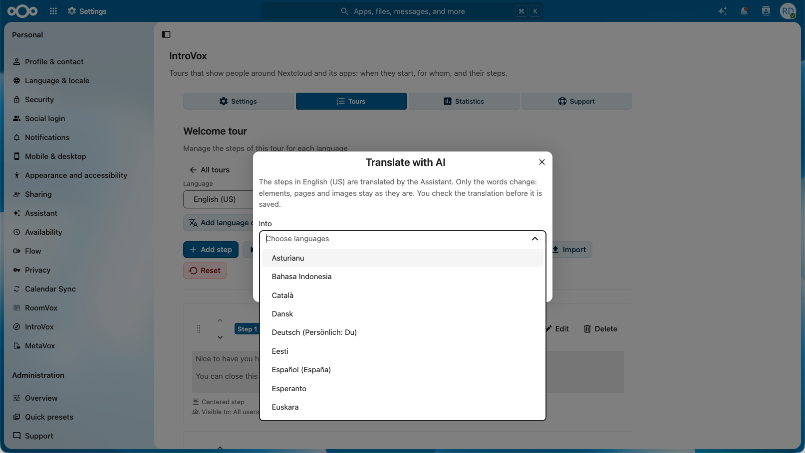
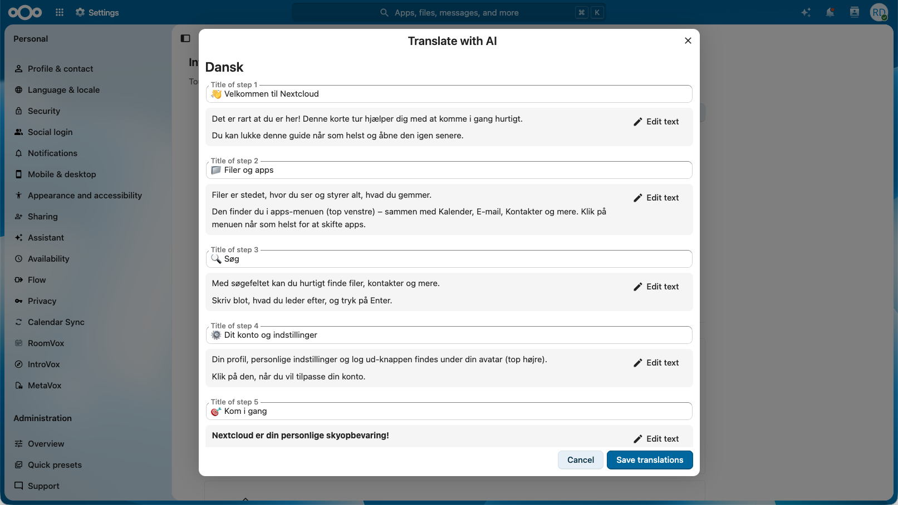
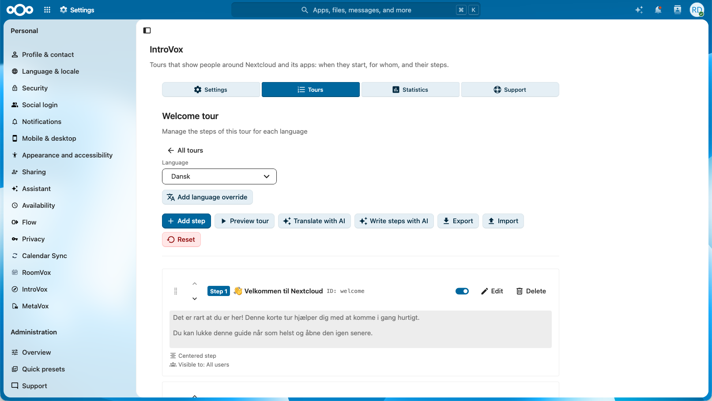

# Tours

Naast de welkomsttour kan IntroVox een korte tour tonen als iemand een app voor het eerst opent, zoals Talk of Deck, of een andere pagina van Nextcloud, of op de eerstvolgende pagina die iemand opent, voor een tip na een paar dagen. Elke tour heeft zijn eigen stappen, talen, publiek en timing.

Alle tours staan onder **Instellingen → Beheer → IntroVox → Tours**.

## De lijst met tours

| Onderdeel | Wat het doet |
|---|---|
| **Welcome tour** | De tour die nieuwe gebruikers na hun eerste login krijgen. Die is er altijd en kan niet weg. |
| **Ingebouwd**-tours | Kant-en-klare tours voor Bestanden, Talk, Deck en Agenda, zie [Ingebouwde tours](#ingebouwde-tours) |
| Schakelaar | Zet die tour aan of uit |
| **Stappen bewerken** | Opent de stappen van de tour: talen, stappen, voorbeeld, exporteren en importeren, zoals beschreven in [Tourstappen beheren](managing-steps.nl.md) |
| ⋯ → **Voorbeeld** | Speelt de hele tour af; een app-tour in zijn hoofdtaal, in zijn app |
| ⋯ → **Link kopiëren** | Zie [Een tour delen met een link](#een-tour-delen-met-een-link) |
| ⋯ → **Tour exporteren** | Zie [Een tour naar een andere Nextcloud verhuizen](#een-tour-naar-een-andere-nextcloud-verhuizen) |
| ⋯ → **Show again to everyone** | Zie [Een tour opnieuw tonen](#een-tour-opnieuw-tonen) |
| ⋯ → **Verwijderen** | Zie [Een tour verwijderen](#een-tour-verwijderen) |
| **Nieuwe tour** | Maakt een tour voor een app, een pagina, of overal |
| **Tour importeren** | Voegt een tour uit een bestand toe, zie [Een tour naar een andere Nextcloud verhuizen](#een-tour-naar-een-andere-nextcloud-verhuizen) |

**Alle tours**, boven de stappen, brengt je terug naar de lijst.

De schakelaar **Tours for everyone** onder **Instellingen** is de hoofdschakelaar: staat die uit, dan start er geen enkele tour, de welkomsttour niet en de andere ook niet, en gebruikers kunnen er ook zelf geen starten.

## Ingebouwde tours

IntroVox heeft korte tours voor **Bestanden**, **Talk**, **Deck** en **Agenda** (Files, Talk, Deck, Calendar), in de lijst gemarkeerd met **Ingebouwd**. Elke tour verschijnt zodra zijn app geïnstalleerd is, en staat eerst uit; zet hem aan en hij werkt als elke andere tour voor een app.

- **De stappen** zijn geschreven en vertaald zoals die van de welkomsttour: gebruikers krijgen ze in hun eigen taal, of in het Engels zolang een vertaling ontbreekt. **Stappen bewerken** laat ze zien; zodra je een taal aanpast, vervangt jouw versie de ingebouwde stappen voor die taal, en **Herstellen** in de stappen-editor haalt ze terug.
- **Tour settings** verandert wie de tour krijgt en wanneer (groepen, **Who gets it**, de dagen en datums). De naam, de app en de hoofdtaal blijven zoals ze zijn.
- Weghalen kan niet: zet ze uit. **Tour exporteren** schrijft de stappen zoals ze zijn, zodat een andere Nextcloud een ingebouwde tour kan importeren als een eigen tour die daar vrij aan te passen is.

Elke tour laat gebruikers het belangrijkste van de app één keer zelf doen, met hun eigen werk, en laat daarna de functies zien die er op het werk het meest toe doen:

- **Bestanden**: een map maken en het delen ervan openen; delen met collega's en teams, een interne link in plaats van een bijlage, mensen buiten de organisatie, activiteit en reacties, Shares, versies en verwijderde bestanden.
- **Talk**: een gesprek voor een team maken en collega's toevoegen; een eerste bericht, bellen, een vergadering plannen, meldingen per gesprek, Home en zoeken.
- **Deck**: een bord openen, een kaart toevoegen, een vervaldatum geven; reacties en bijlagen, het bord delen, en waar de kaart terugkomt in Upcoming cards.
- **Agenda**: een afspraak plannen en opslaan, met deelnemers en Find a time; weergaven, agenda's voor projecten en teams, de telefoon, afspraakschema's en de prullenbak.

De doe-stappen gaan verder zodra de gebruiker klikt of een veld invult; de volgende wacht tot wat de klik opende er is (zie [Stappen die op de gebruiker wachten](managing-steps.nl.md#stappen-die-op-de-gebruiker-wachten)). Ze laten bewust iets echts achter, een map, een gesprek, een kaart, een afspraak, genoemd naar het eigen werk van de gebruiker.

De stappen wijzen naar onderdelen van de apps die tussen versies en talen hetzelfde blijven, zoals de knop **Nieuw** in Bestanden of de lijst met agenda's, nooit naar een label. Verandert een app er toch een, dan wacht die stap opzij met zijn tekst, en gaat **Volgende** gewoon verder.

## Een tour voor een app maken

1. Klik op **Nieuwe tour**.
2. Kies bij **Where does it start?**:
   - **In een app**, en kies de app;
   - **Op een andere pagina**, en typ een pagina van deze Nextcloud, zoals `/settings/user`. Een pagina in een app, zoals `/apps/files/…`, telt als die app;
   - **Overal**: op de eerstvolgende pagina die iemand opent. Met een aantal dagen (hieronder) wordt dit een tip die komt als iemand zijn weg gevonden heeft, zoals "Wist je dat je een map met een link kunt delen?".
3. Klik op **Volgende** en vul in:
   - **Naam**: wat beheerders en gebruikers in de lijsten met tours zien. Bij een app begint die als de naam van de app.
   - **Hoofdtaal**: de taal waarin je de stappen als eerste schrijft. Wie een taal heeft zonder eigen stappen, krijgt deze.
   - **Zichtbaar voor**: groepen die de tour krijgen. Leeg betekent alle gebruikers.
   - **Who gets it**: **Iedereen** die de app opent en de tour nog niet zag, ook wie de app al jaren gebruikt, of **Alleen nieuwe accounts**: mensen van wie de eerste login na de eerste keer aanzetten van de tour komt.
   - **When it starts by itself**: **Dagen na de eerste aanmelding** (0 start meteen), en **Van** en **Tot**, beide dagen meegerekend, in de tijdzone van elke gebruiker. Laat de datums leeg voor geen grens.
4. Klik op **Aanmaken**. De stappen-editor opent met een eerste stap; nieuwe stappen horen bij de app van de tour. **Element kiezen** en **Tour bekijken** openen die app. Stappen van een tour die overal start hebben geen eigen pagina: ze verschijnen op de pagina waar de tour start, dus ze wijzen naar iets dat elke pagina heeft, zoals de kopbalk, of staan in het midden.
5. Zet de tour terug in de lijst aan. Dat kan zodra hij minstens één stap in zijn hoofdtaal heeft.

Een nieuwe tour staat eerst uit, zodat niemand hem ziet terwijl je er nog aan schrijft. **Tour settings**, boven de stappen, verandert de naam, de taal, de groepen, wie hem krijgt en wanneer.

### Andere talen

**Taalspecifieke versie toevoegen** in de stappen-editor voegt stappen in een andere taal toe, net als bij de welkomsttour. Iemand krijgt de stappen in de eigen taal; zijn die er niet, dan die van de basistaal (`de` voor `de_DE`); zijn die er ook niet, dan die van de hoofdtaal. Tours die je zelf maakt hebben geen vertaalde standaardstappen: alleen de stappen die jij schrijft. De ingebouwde tours wel: zonder stappen van jou in de eigen taal of de basistaal krijgt iemand de ingebouwde stappen in de eigen taal, vóór jouw stappen in de hoofdtaal. Alleen voor een taal die Transifex nog niet vertaald heeft, gaan jouw stappen in de hoofdtaal voor.

## Stappen schrijven of vertalen met AI

Is er een provider voor de Nextcloud Assistant ingesteld (**Beheerinstellingen → Artificial intelligence**, een provider voor vrije prompts), dan heeft de stappen-editor twee knoppen meer. Zonder provider zijn ze er niet.

- **Translate with AI** vertaalt de stappen van de taal die je bewerkt naar een of meer andere talen. Alleen titels, teksten en beschrijvingen van afbeeldingen veranderen; elementen, pagina's, media en groepen blijven zoals ze zijn. Stappen die een taal al heeft, worden bij opslaan vervangen.
- **Write steps with AI** schrijft drie tot zes stappen, in de taal die je bewerkt, op basis van een beschrijving van wat de tour moet uitleggen. Ze komen na de stappen die er al zijn, midden in beeld: kies daarna per stap een element.

Er wordt niets opgeslagen voordat jij het hebt gecontroleerd: de dialoog toont elke stap, en je kunt titels en teksten daar aanpassen. Een antwoord gaat door dezelfde controles als een geïmporteerd bestand; een antwoord dat niet past, wordt in zijn geheel geweigerd. Taken lopen op de achtergrond, dus hoe snel een antwoord komt, hangt af van de provider en van de achtergrondworkers van Nextcloud voor AI-taken. Een beheerder kan per uur 60 vertalingen en 60 concepten starten.

Een hele tour levert een lang antwoord op. Zet bij de integratie OpenAI and LocalAI **Max output tokens per request** op 8000 of meer: de standaardwaarde van 1000 kapt een tour halverwege af, en modellen die eerst nadenken gebruiken daar een deel van. Een afgekapt antwoord meldt de dialoog als zodanig.

Wat er naar de provider gaat: de titels, teksten en beschrijvingen van afbeeldingen van de stappen, of jouw beschrijving en de naam van de app van de tour. Welke provider dat is, op deze server of elders, stel je in bij de AI-instellingen.

## Wanneer een tour start

Een app-tour start vanzelf als dit allemaal klopt:

- hij staat aan, en **Tours for everyone** ook;
- de gebruiker zit in een van zijn groepen, als hij die heeft, en kan de app openen;
- de gebruiker opent de app of pagina, en de app is klaar met laden; een tour die overal start: elke pagina behalve de beheerpagina van IntroVox zelf;
- de gebruiker heeft deze tour nog niet gezien. Is hij eenmaal gestart, in welke browser ook, dan start hij niet nog eens vanzelf;
- het is zijn tijd: minstens het aantal dagen na de eerste login, en tussen zijn datums, als hij die heeft;
- **Start tours by themselves** staat aan in de persoonlijke instellingen.

Een tour start nooit boven op een andere tour. Wie de welkomsttour nog niet had, krijgt die eerst, waar hij ook inlogt, en de app-tour bij een later bezoek. Met twee tabbladen van dezelfde app open verschijnt hij in één.

Gebruikers vinden alle tours die ze kunnen krijgen onder **Persoonlijke instellingen → IntroVox**, met **Start** om er zelf een te starten, en **Tours** in hun gebruikersmenu, boven **Help**, leidt daarheen. Zelf starten werkt ook als **Start tours by themselves** uit staat, en los van de datums van de tour. Een tour die overal start, start van daaruit in Bestanden. Een andere app, zoals een helppagina, kan dezelfde tours als links tonen (zie [De tourlijst insluiten](../architecture/frontend-architecture.nl.md#de-tourlijst-insluiten)).

**Show Tours in the user menu** onder **Instellingen** verbergt dat menu-item.

Wie niet in de groepen van de tour zit, krijgt er niets van: de server antwoordt alsof de tour niet bestaat.

## Een tour delen met een link

**Link kopiëren** in het ⋯-menu van een tour kopieert een link, zoals `https://cloud.example.com/index.php/apps/introvox/tour/builtin-talk` (zonder `index.php` op een Nextcloud met pretty URLs), die de pagina van de tour opent en de tour daar start, voor een welkomstmail of een bericht aan een team. Voor de welkomsttour en een tour die overal start opent de link Bestanden.

De link openen is als **Start** in de persoonlijke instellingen: de tour start ook als iemand hem al zag, **Start tours by themselves** uit heeft gezet of buiten de datums van de tour valt, en het telt niet mee in de statistieken. Hij start wel alleen voor wie de tour mag krijgen: wie buiten de groepen van de tour valt of de app niet heeft, krijgt de pagina zonder tour. Een tour die uit staat, start voor niemand: de link opent dan Bestanden, en **Link kopiëren** waarschuwt daarvoor. Wie niet ingelogd is, logt eerst in en krijgt dan de tour. De adresbalk raakt het linkdeel kwijt zodra de pagina het gelezen heeft, zodat een bladwijzer, of herladen nadat de tour klaar is, de tour niet opnieuw start.

## Een tour opnieuw tonen

**Show again to everyone** geeft de tour opnieuw aan iedereen die hem zag, de volgende keer dat ze de app openen. Wie **Start tours by themselves** uit heeft gezet, houdt dat: die krijgt hem niet vanzelf, maar kan hem starten vanuit de persoonlijke instellingen.

Voor de welkomsttour werkt het net zo.

## Een tour verwijderen

**Verwijderen** verwijdert de tour, zijn stappen in alle talen en wie hem zag. IntroVox bewaart de laatste tien verwijderde tours als back-up in zijn app-datamap, maar er is geen knop om er een terug te halen: gebruik eerst **Tour exporteren** als je hem misschien terug wilt.

De welkomsttour kan niet weg; zet hem uit.

## Statistieken

Het paneel **Statistieken** toont de cijfers van één tour tegelijk: kies hem bij **Tour**.

- **Gebruikers die de tour hebben gestart**, **Gebruikers die de tour hebben afgerond**, **Users skipped** en het **Voltooiingspercentage**: mensen, geen klikken. Wie een tour twee keer doorloopt, telt één keer.
- **Hoe ver mensen komen**: per stap hoeveel mensen minstens zo ver kwamen. Een stap waar de balk flink zakt, is waar mensen afhaken; misschien is hij te lang, of wijst hij naar iets dat ze niet vinden. **Steps in** kiest de taal waarvan de stappen getoond worden.

Hoe ver mensen komen, telt vanaf de laatste keer dat de tour vanzelf voor iemand startte. Zelf starten vanuit de persoonlijke instellingen, een voorbeeld en een stap teruggaan tellen niet. Na **Show again to everyone** vervangt iemands nieuwe run de oude. Het tellen begint met deze versie van IntroVox: runs van daarvoor staan niet in de balken.

De statistieken zijn alleen totalen: niemand kan zien hoe ver één bepaalde persoon kwam, en niets ervan gaat mee met de anonieme gebruiksstatistieken.

## Een tour naar een andere Nextcloud verhuizen

**Tour exporteren** in het ⋯-menu van een tour downloadt één `.zip`-bestand: de instellingen van de tour, zijn stappen in alle talen en de afbeeldingen en video's die ze gebruiken. **Tour importeren**, naast **Nieuwe tour**, voegt een tour uit zo'n bestand toe: **Upload a file**, of **Kies uit Bestanden** voor een bestand in je eigen Bestanden. Gebruik Bestanden voor grote tours: de server kan uploads boven een bepaalde grootte weigeren.

Een geïmporteerde tour:

- is een nieuwe tour, die uit staat tot je hem aanzet;
- houdt zijn groepen alleen waar deze Nextcloud een groep met dezelfde id heeft. De andere vallen weg, en een melding noemt ze;
- krijgt eigen kopieën van zijn afbeeldingen en video's, gecontroleerd als een upload. Eén die boven de grenzen van deze server uitkomt, valt weg uit zijn stap, met een melding;
- start pas in zijn app als die app hier geïnstalleerd is; zo niet, dan krijg je een melding.

De **Welcome tour** exporteert alleen de stappen die je zelf schreef, niet de vertaalde standaardstappen die elke Nextcloud heeft. Importeren vervangt de eigen stappen van de welkomsttour voor de talen in het bestand, nadat je dat bevestigt.

Een bestand dat niet uit IntroVox geëxporteerd is, of zo veranderd is dat IntroVox het niet kan accepteren, wordt in zijn geheel geweigerd en er verandert niets. **Exporteren** en **Import** in de stappen-editor verhuizen nog steeds de stappen van één taal, zie [Import/Export](import-export.nl.md).

## Grenzen

- Hooguit 50 tours.
- Een tourbestand voor **Tour importeren** bevat uitgepakt hooguit 100 MB. Een beheerder met toegang tot de server kan dat aanpassen: `occ config:app:set introvox tour_package_limit --value=<bytes>`.
- Op de beheerpagina van IntroVox zelf start geen tour, zodat hij de beheerders-tour niet in de weg zit.

## Zie ook

- [Tourstappen beheren](managing-steps.nl.md): de stappen schrijven
- [Talenbeheer](language-management.nl.md): talen en overrides
- [Groep-gebaseerde zichtbaarheid](group-visibility.nl.md): groepen per stap
- [Persoonlijke instellingen](../user/personal-settings.nl.md): wat gebruikers zien
