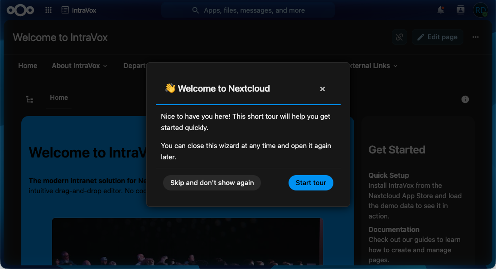

# Theme Support

IntroVox automatically adapts to all Nextcloud themes. No configuration needed.

## Supported Themes

- ✅ **Light mode** (default)
- ✅ **Dark mode** (via system preference or Nextcloud setting)
- ✅ **High contrast mode** (accessibility)
- ✅ **Custom themes** (via the Nextcloud Theming app)

## How It Works

The wizard uses Nextcloud's CSS variables rather than hardcoded colors:

| Variable | Purpose |
|---|---|
| `--color-main-background` | Step background |
| `--color-main-text` | Body text |
| `--color-primary-element` | Accent (buttons, highlight borders) |
| `--color-border` | Step container border |
| `--color-background-hover` | Hover states on buttons |

Because these variables are scoped to the document and updated by Nextcloud's theming system, the wizard automatically picks up any theme change — including custom themes deployed via the Theming app.

## Accessibility

### Reduced Motion

If the user's system has the "reduce motion" accessibility preference enabled, the tour keeps still:

- Steps appear without fading in (for everyone else they fade in within 0.15 seconds)
- The arrow and the outline around a step's element stand still
- GIFs and videos don't play by themselves; they start with their play button
- The tour jumps to a step instead of scrolling smoothly, and so does the step list on the admin page

For everyone else, the arrow and the outline blink a few times and then stay still too, instead of blinking for as long as the step shows.

### High Contrast

In high-contrast mode, the wizard uses enhanced border widths and color contrasts to remain readable.

### Keyboard Focus

All interactive elements have visible focus indicators that adapt to the current theme — they remain clearly visible in both light and dark modes.

### Semantic HTML and ARIA

Steps use semantic HTML (Shepherd renders the title as `<h3 class="shepherd-title">`, actions as `<button>`) and ARIA labels where needed, so screen readers can announce content correctly.

## Custom CSS

IntroVox does not currently support custom CSS overrides via the admin panel. If you need custom styling, you can:

- Use the Nextcloud Theming app to adjust global CSS variables (changes apply to IntroVox automatically)
- Deploy custom CSS at the Nextcloud level (via the Theming app's "Custom CSS" feature)

Inline styles inside step HTML are removed when the step is shown (see [Inline Styles](customization.md#inline-styles)), so they can't break theme inheritance. Use the Theming app instead.

## See Also

- [Customization](customization.md) — HTML, CSS selectors, positioning
- [Keyboard Navigation](../user/keyboard-navigation.md) — Accessibility features for users
- [Architecture Overview](../architecture/overview.md) — How the frontend integrates with Nextcloud's theming
