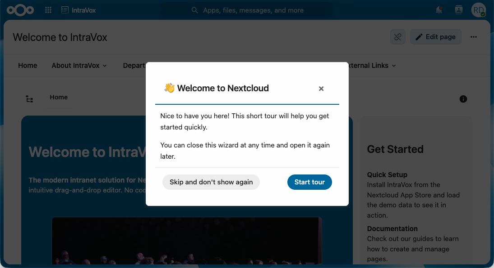

# IntroVox Documentation

Welcome to the IntroVox documentation. IntroVox is a Nextcloud app with guided tours: a welcome tour for new users, and short tours that start the first time someone opens an app or a page, such as the built-in tours for Files, Talk, Deck and Calendar. It is built with Vue 3 and Shepherd.js, translates its default steps through Transifex, and has an admin page to write tours, choose who gets them and when, and see how far people get.

*The first step of the welcome tour.*

## Quick Navigation

### For Users

How to take a tour, start one again, and choose whether tours start by themselves.

- [Overview](user/overview.md) — What IntroVox is and how the tour works
- [Taking the Tour](user/taking-the-tour.md) — Navigating steps, highlighted elements, centered vs. attached
- [Personal Settings](user/personal-settings.md) — Restart, let tours start by themselves or not, start a tour yourself
- [Keyboard Navigation](user/keyboard-navigation.md) — Shortcuts and accessibility features
- [Mobile Experience](user/mobile.md) — Responsive layout, touch interactions
- [Troubleshooting](user/troubleshooting.md) — Tour not starting, missing steps, language issues
- [FAQ](user/faq.md) — Common user questions
- [Tips](user/tips.md) — Getting the most out of Nextcloud

### For Administrators

Installation, configuration, step management, and operations.

- [Admin Guide](admin/guide.md) — Day-to-day administration
- [Settings](admin/settings.md) — Every option on the admin page, the checklist on the Dashboard, and where settings are stored
- [Language Management](admin/language-management.md) — Override-based per-language customisation (Transifex provides defaults automatically)
- [Tours](admin/tours.md) — The welcome tour, built-in tours, tours for an app, a page or anywhere; timing, share links, statistics, AI, export and import
- [Managing Tour Steps](admin/managing-steps.md) — Writing steps: text, images and videos, elements, steps that wait for the user, reordering, reset
- [Group-Based Visibility](admin/group-visibility.md) — Role-based onboarding with group filters
- [Import/Export](admin/import-export.md) — The steps of one language as a JSON file
- [Best Practices](admin/best-practices.md) — Content guidelines, language strategy, maintenance
- [Troubleshooting](admin/troubleshooting.md) — Tour not starting, missing steps, translations
- [Telemetry](admin/telemetry.md) — The optional anonymous usage statistics: what is sent, and how to switch them off
- [FAQ](admin/faq.md) — Common admin questions

### Features

Per-feature documentation for capabilities.

- [Guided Tours](features/guided-tours.md) — How a tour runs: which tour starts, step types, steps that wait, tours across apps
- [Multi-Language Support](features/multi-language.md) — Transifex integration, auto-detection, per-language steps
- [Step Visibility](features/step-visibility.md) — Group filters + user preferences
- [Customization](features/customization.md) — HTML in step content, CSS selectors, positioning
- [Theme Support](features/theme-support.md) — Light, dark, high contrast, custom Nextcloud themes

### For Architects & Developers

Technical documentation for integration, evaluation, and contribution.

- [Architecture Overview](architecture/overview.md) — System design and components
- [API Reference](architecture/api-reference.md) — REST API endpoints
- [Frontend Architecture](architecture/frontend-architecture.md) — Vue 3 + Shepherd.js structure
- [Backend Architecture](architecture/backend-architecture.md) — Controllers, services, config storage
- [Transifex Integration](architecture/transifex-integration.md) — Translation workflow

### Security

- [Media in tour steps](security/media.md) — Threat model for images and videos in steps

### Deployment

Installing and upgrading IntroVox.

- [Installation](deployment/installation.md) — Install from the App Store or source, and upgrade

## Getting Started

New to IntroVox? Start with the [Getting Started Guide](getting-started.md) for a per-role quickstart.

## Support

- **Issues & Feature Requests**: [GitHub Issues](https://github.com/nextcloud/IntroVox/issues)
- **Source Code**: [GitHub Repository](https://github.com/nextcloud/IntroVox)

## License

IntroVox is licensed under the [AGPL-3.0 License](https://www.gnu.org/licenses/agpl-3.0.html).
