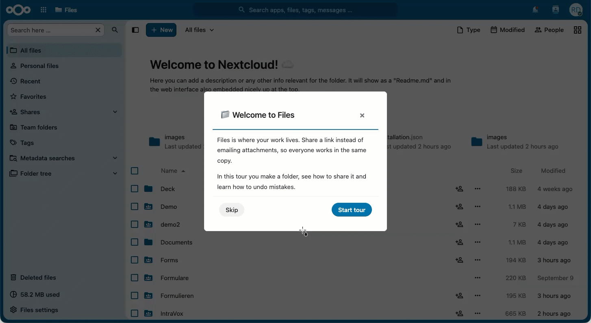

# IntroVox documentatie

Welkom bij de IntroVox-documentatie. IntroVox is een Nextcloud-app met geleide tours: een welkomsttour voor nieuwe gebruikers, en korte tours die starten als iemand voor het eerst een app of pagina opent, zoals de ingebouwde tours voor Files, Talk, Deck en Calendar. Hij is gebouwd met Vue 3 en Shepherd.js, laat zijn standaardstappen vertalen via Transifex, en heeft een beheerpagina om tours te schrijven, te kiezen wie ze krijgt en wanneer, en te zien hoe ver mensen komen.

*De ingebouwde tour voor Bestanden, zoals gebruikers hem krijgen als ze Bestanden voor het eerst openen.*

## Snelle navigatie

### Voor gebruikers

Hoe je een tour volgt, er een opnieuw start, en kiest of tours vanzelf starten.

- [Overzicht](user/overview.nl.md) — Wat is IntroVox en hoe werkt de tour
- [De tour doorlopen](user/taking-the-tour.nl.md) — Stappen doorlopen, gemarkeerde elementen, centered vs. attached
- [Persoonlijke instellingen](user/personal-settings.nl.md) — Herstarten, tours vanzelf laten starten of niet, tours zelf starten
- [Toetsenbordnavigatie](user/keyboard-navigation.nl.md) — Sneltoetsen en toegankelijkheid
- [Mobiele ervaring](user/mobile.nl.md) — Responsive layout, touch-interacties
- [Problemen oplossen](user/troubleshooting.nl.md) — Tour start niet, ontbrekende stappen, taalproblemen
- [FAQ](user/faq.nl.md) — Veelgestelde gebruikersvragen
- [Tips](user/tips.nl.md) — Het meeste halen uit Nextcloud

### Voor beheerders

Installatie, configuratie, stappenbeheer en operations.

- [Beheergids](admin/guide.nl.md) — Dagelijks beheer
- [Instellingen](admin/settings.nl.md) — Elke optie op de beheerpagina, de checklist op het Dashboard, en waar instellingen worden opgeslagen
- [Talenbeheer](admin/language-management.nl.md) — Eigen tekst per taal via overrides (Transifex levert de standaardstappen automatisch)
- [Tours](admin/tours.nl.md) — De welkomsttour, ingebouwde tours, tours voor een app, een pagina of overal; timing, links, statistieken, AI, exporteren en importeren
- [Tourstappen beheren](admin/managing-steps.nl.md) — Stappen schrijven: tekst, afbeeldingen en video's, elementen, stappen die op de gebruiker wachten, volgorde, reset
- [Groep-gebaseerde zichtbaarheid](admin/group-visibility.nl.md) — Rol-gebaseerde onboarding met groepsfilters
- [Import / Export](admin/import-export.nl.md) — De stappen van één taal als JSON-bestand
- [Best practices](admin/best-practices.nl.md) — Contentrichtlijnen, taalstrategie, onderhoud
- [Problemen oplossen](admin/troubleshooting.nl.md) — Tour start niet, ontbrekende stappen, vertalingen
- [Telemetrie](admin/telemetry.nl.md) — De optionele anonieme gebruiksstatistieken: wat er verstuurd wordt, en hoe je ze uitzet
- [FAQ](admin/faq.nl.md) — Veelgestelde beheerdersvragen

### Features

Per-feature documentatie voor mogelijkheden.

- [Geleide tours](features/guided-tours.nl.md) — Hoe een tour loopt: welke tour start, staptypen, stappen die wachten, tours over meerdere apps
- [Meertalige ondersteuning](features/multi-language.nl.md) — Transifex-integratie, auto-detectie, per-taal stappen
- [Zichtbaarheid van stappen](features/step-visibility.nl.md) — Groepsfilters en gebruikersvoorkeuren
- [Customization](features/customization.nl.md) — HTML in stapinhoud, CSS-selectors, positionering
- [Thema-ondersteuning](features/theme-support.nl.md) — Light, dark, high contrast, custom Nextcloud-thema's

### Voor architecten & ontwikkelaars

Technische documentatie voor integratie, evaluatie en bijdragen.

- [Architectuuroverzicht](architecture/overview.nl.md) — Systeemontwerp en componenten
- [API-referentie](architecture/api-reference.nl.md) — REST API-endpoints
- [Frontend-architectuur](architecture/frontend-architecture.nl.md) — Vue 3 + Shepherd.js-structuur
- [Backend-architectuur](architecture/backend-architecture.nl.md) — Controllers, services, configuratie-opslag
- [Transifex-integratie](architecture/transifex-integration.nl.md) — Vertaling-workflow

### Beveiliging

- [Media in tour-stappen](security/media.md) — Dreigingsmodel voor afbeeldingen en video's in stappen (in het Engels)

### Deployment

IntroVox installeren en bijwerken.

- [Installatie](deployment/installation.nl.md) — Installeren vanuit de App Store of source, en bijwerken

## Aan de slag

Nieuw bij IntroVox? Begin met de [Aan de slag-gids](getting-started.nl.md) voor een rol-gebaseerde quickstart.

## Support

- **Issues & feature requests**: [GitHub Issues](https://github.com/nextcloud/IntroVox/issues)
- **Broncode**: [GitHub-repository](https://github.com/nextcloud/IntroVox)

## Licentie

IntroVox is gelicenseerd onder de [AGPL-3.0-licentie](https://www.gnu.org/licenses/agpl-3.0.html).
