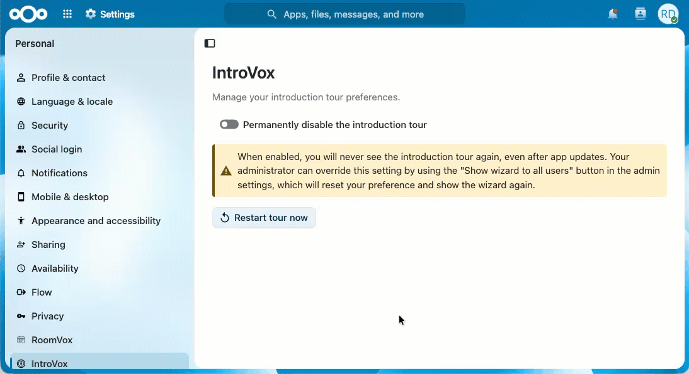

# IntroVox Overview (User Guide)

Welcome to **IntroVox** — your personal guide to Nextcloud.

IntroVox is an interactive tour that helps you discover Nextcloud's most important features when you first log in. Think of it as a friendly companion that shows you around your new cloud workspace. Your administrator can add short tours for apps too, and a "Getting started" list on your Dashboard.

## What You'll Learn

The welcome tour guides you through topics like:

- 📁 **Files & apps** — Where your files are, and the apps menu to switch between apps
- 🔍 **Search** — Find files, contacts and more
- ⚙️ **Your account & settings** — Your profile, settings and log out, under your avatar
- 💡 **Useful tips** — Such as dragging files into your browser and sharing a file with a link

The exact steps depend on what your administrator has configured for your language.

## How Long Does It Take?

Most tours take **2–5 minutes**. You can:

- ✅ Complete it in one go
- ⏸️ Close it and start it again later from your personal settings
- ⏭️ Skip it entirely if you prefer to explore on your own

## First Login Experience

When you log in for the first time, the welcome tour starts by itself on the first page you open, a moment after it has loaded. You'll see a welcome step with two options:

1. **Start tour** — Begin the interactive guide (recommended for new users)
2. **Skip and don't show again** — Close the tour and prevent it from showing in the future

See [Taking the Tour](taking-the-tour.md) for the full walkthrough.

## Tours for Apps

Your administrator can also give you a short tour for an app, such as Files, Talk, Deck or Calendar. It starts by itself the first time you open that app, once. Some of its steps ask you to do something, such as clicking a button or filling in a name, so you learn the app with your own work.

- **All your tours** are under **Personal Settings → IntroVox**, each with **Start**. **Tours** in your user menu, above **Help**, leads there. See [Personal Settings](personal-settings.md#tours-for-apps).
- **A link** from your administrator, for example in a welcome mail, opens the app and starts its tour there.

## "Getting Started" on the Dashboard

Your administrator can add a **Getting started** list to your Dashboard: first things to do in Nextcloud, such as uploading a file or adding a profile picture. Each task links to where you do it, and ticks itself off once you have done it. You can remove the list, or add it back, under **Customize** on your Dashboard.

## If the Tour Doesn't Appear

The tour might not show automatically if:

- Your administrator has disabled it globally
- You switched off **Start tours by themselves** in your personal settings
- You already completed the tour (it only shows again if you restart it)

(IntroVox itself is available in every language Nextcloud supports. If a particular language has no translation on Transifex yet, the tour falls back to English so you still get readable text.)

You can always start it manually — see [Personal Settings](personal-settings.md).

## See Also

- [Taking the Tour](taking-the-tour.md) — Navigating the tour
- [Personal Settings](personal-settings.md) — Restart and preferences
- [Keyboard Navigation](keyboard-navigation.md) — Shortcuts and accessibility
- [FAQ](faq.md) — Common questions
