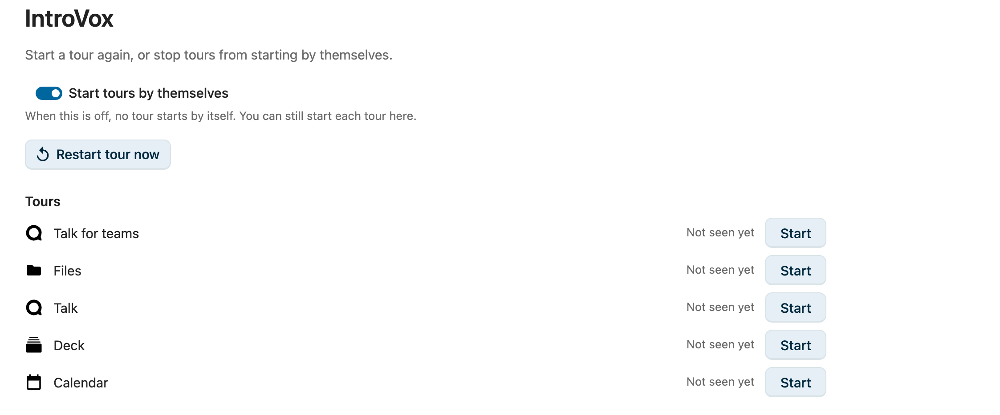

# Persoonlijke instellingen

Je kunt je IntroVox-tour-voorkeuren op elk moment beheren via je persoonlijke instellingen: de welkomsttour die je na je eerste login krijgt, en de tours die je beheerder voor apps heeft gemaakt.



## Je IntroVox-instellingen openen

1. Klik op je **profielfoto** of **gebruikersnaam** rechtsboven
2. Kies **Tours**, net boven **Help**

Of: **Persoonlijke instellingen**, en dan **IntroVox** in de linker-sidebar. Je beheerder kan het item **Tours** verbergen; de pagina is er altijd.

## Beschikbare opties

In je persoonlijke instellingen kun je:

- **Start tours by themselves** — zet je dit uit, dan start er geen tour meer vanzelf
- **De tour herstarten** — bekijk de welkomsttour opnieuw
- **Een tour voor een app starten** — onder **Tours**, als je beheerder die heeft gemaakt

## De tour herstarten

### Methode 1 — vanuit persoonlijke instellingen

1. Navigeer naar **Persoonlijke instellingen → IntroVox**
2. Klik op **🔄 Tour nu herstarten**
3. Je wordt naar het dashboard geleid
4. De tour start automatisch

### Methode 2 — browser-console (geavanceerd)

1. Druk op **F12** om Developer Tools te openen
2. Ga naar het **Console**-tabblad
3. Typ:

   ```js
   window.introVox.start()
   ```

4. Druk op **Enter**

Dit start de welkomsttour. Het werkt alleen wanneer je al ingelogd bent en op een Nextcloud-pagina staat.

### Wanneer herstarten

- Na een grote Nextcloud-update (er kunnen nieuwe features aan de tour zijn toegevoegd)
- Wanneer je Nextcloud leert voor een project of nieuwe rol
- Om je kennis op te frissen na een tijdje geen Nextcloud te hebben gebruikt
- Om Nextcloud te tonen aan een collega of vriend

## Tours voor apps

Naast de welkomsttour kan je beheerder een korte tour maken voor een app, zoals Talk, of voor een andere pagina van Nextcloud. Zo'n tour start vanzelf de eerste keer dat je die app opent, één keer; hij start niet opnieuw in een andere browser of op een ander apparaat. Hij start nooit bovenop de welkomsttour: heb je de welkomsttour nog niet gehad, dan krijg je die eerst, en de tour van de app bij een later bezoek.

Zijn er zulke tours voor je, dan staan ze in **Persoonlijke instellingen → IntroVox** onder **Tours**. Bij elke tour zie je het icoon van de app, de naam, en **Seen** of **Not seen yet**. Klik op **Start** (of **Start again**) om de app te openen en de tour te starten. Dat werkt ook als **Start tours by themselves** uit staat.

## Tours niet meer vanzelf laten starten

### Alle tours

1. **Persoonlijke instellingen → IntroVox**
2. Zet **Start tours by themselves** uit; de instelling wordt direct opgeslagen

Staat hij uit, dan start er geen tour vanzelf: de welkomsttour niet, en de tours voor apps ook niet. Je kunt elke tour nog wel zelf starten vanaf dezelfde pagina. Standaard staat de schakelaar aan.

> Had je de tour in je persoonlijke instellingen uitgezet voordat IntroVox tours voor apps had, dan staat **Start tours by themselves** na die update uit. Zet hem aan als je de tours voor apps wel wilt krijgen.

### Alleen de welkomsttour

- Klik in de eerste stap op **Skip and don't show again**, of
- Klik in de laatste stap op **Done**

Allebei markeren ze de welkomsttour als klaar voor jou. Andere tours blijven aan: een tour voor een app start nog steeds de eerste keer dat je die app opent.

In een tour voor een app heeft de eerste stap in plaats daarvan een knop **Skip**. Die tour start daarna niet meer vanzelf.

> **Let op:** je kunt de welkomsttour altijd herstarten via **Persoonlijke instellingen → IntroVox**. Je beheerder kan de welkomsttour ook opnieuw aan iedereen tonen; je krijgt hem dan bij je volgende login, tenzij je **Start tours by themselves** hebt uitgezet.

## Tijdelijk negeren

Als je het druk hebt en de welkomsttour voor nu wilt overslaan:

- Klik op **✕** rechtsboven
- De tour sluit en telt in deze browser als gezien; in een andere browser start hij opnieuw, en je kunt hem zelf starten vanuit deze instellingen

Dit is handig als je onderbroken wordt en hem later wilt afronden.

Een tour voor een app komt niet vanzelf terug als hij eenmaal gestart is, ook niet na **✕**. Start hem opnieuw via **Tours** in je persoonlijke instellingen.

## "Tour niet beschikbaar"-bericht

Je kunt in plaats van de herstart-knop dit bericht zien in persoonlijke instellingen:

### "De introductie-tour is momenteel uitgeschakeld door je beheerder"

Je Nextcloud-beheerder heeft de tours voor alle gebruikers uitgezet. Er start geen tour, de welkomsttour niet en een tour voor een app ook niet, en je kunt er zelf ook geen starten. Neem contact op met je beheerder als je hem alsnog wilt zien.

> Eerdere IntroVox-versies toonden ook een melding "niet beschikbaar in je taal" als een beheerder talen had beperkt. Sinds v1.7.0 is de tour automatisch beschikbaar in elke taal die Nextcloud ondersteunt (via Transifex), dus die melding bestaat niet meer.

## Zie ook

- [De tour doorlopen](taking-the-tour.md) — hoe je door de tour navigeert
- [Problemen oplossen](troubleshooting.md) — als dingen niet werken
- [FAQ](faq.md) — veelgestelde vragen
