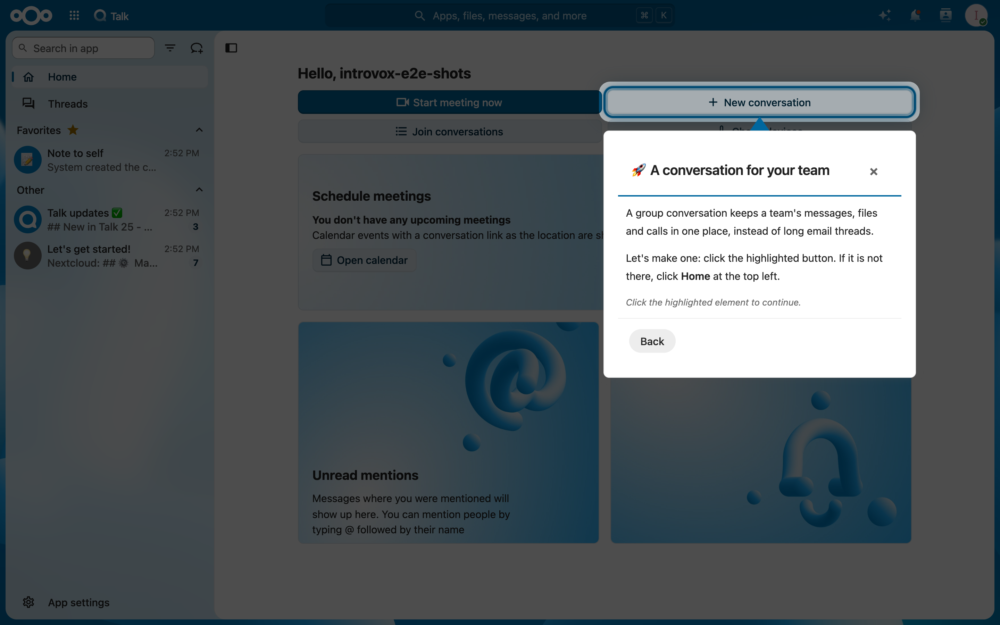

# De tour doorlopen

Deze gids legt uit hoe je door de IntroVox-tour navigeert, wat het tour-venster bevat, wat het verschil is tussen gecentreerde en gekoppelde stappen, en hoe stappen werken die je iets laten doen.

## Het tour-venster

Elke stap toont:

**Header**

- **Titel** — waar deze stap over gaat (bv. `📁 Bestanden`)
- **Sluit-knop (✕)** — verlaat de tour zonder hem permanent uit te schakelen

**Inhoud**

- **Beschrijving** — informatie over de feature
- **Nuttige tips** — best practices en sneltoetsen
- **Afbeelding of video** — sommige stappen tonen er een boven de tekst
- **Visuele markeringen** — belangrijke UI-elementen worden omlijnd

**Footer**

- **Back** — naar de vorige stap
- **Next** / **Done** — doorgaan, of afronden bij de laatste stap

## Navigeren door stappen

### Vooruit gaan

- Klik op **Next**, of druk op de pijltjestoets naar rechts (`→`)

### Terug gaan

- Klik op **Back**, of druk op de pijltjestoets naar links (`←`)

### Verlaten

- Klik op **✕** rechtsboven
- Of druk op `Escape`
- Zo afsluiten **zet** tours **niet uit**. Deze browser onthoudt het, dus de welkomsttour start hier niet meer vanzelf; in een andere browser of op een ander apparaat wel

## Gemarkeerde elementen

Wanneer een stap een specifiek onderdeel van de Nextcloud-interface markeert:

- Het element heeft een **rand** in de kleur van je thema
- Een **knipperend pijltje** wijst vanaf de stap naar het element
- De rest van het scherm wordt licht **gedimd**

Voorbeeld: wanneer de tour de Files-app toont, is het Files-menu-item gemarkeerd zodat je het later makkelijk kunt vinden.

## Gecentreerde vs. gekoppelde stappen

Je ziet twee soorten stappen:

### Gecentreerde stappen

- Verschijnen in het midden van je scherm
- Worden gebruikt voor algemene informatie, welkom en afsluiting
- Er wordt geen specifiek element gemarkeerd

### Gekoppelde stappen

- Verschijnen naast een specifiek UI-element
- Wijzen naar features waar je vanaf moet weten
- Tonen precies waar je dingen kunt vinden

### Stappen die wachten

Soms staat het element waar een stap over gaat nog niet op de pagina, bijvoorbeeld omdat je eerst nog iets moet openen of aanmaken. De stap wacht dan met zijn tekst rechtsonder opzij (linksonder zolang er een venster open is, zodat hij de knoppen van het venster vrijlaat). De pagina blijft bruikbaar, en de stap schuift naar het element zodra het verschijnt, hoe lang je er ook over doet. **Next** gaat ook zonder het element verder.

## Stappen die je iets laten doen

Sommige stappen laten je dingen uitproberen in plaats van erover te lezen. Tours voor apps doen dat vaak. Wat je erin maakt is echt: de map, het gesprek of de kaart blijft van jou.

- **Klikken:** de stap zegt "Click the highlighted element to continue." en heeft geen knop **Next**. Klik op het element, en de tour gaat vanzelf verder, ook als de klik een andere app opent.
- **Invullen:** de stap zegt "Fill in the highlighted field to continue." **Next** werkt zodra het veld tekst heeft, zoals de naam van een nieuw gesprek.

Staat het element niet op de pagina, dan werkt **Next** gewoon, zodat je nooit vastloopt.

## Afbeeldingen en video's

Een stap kan boven zijn tekst een afbeelding, GIF of video tonen. Alles wat beweegt heeft een pauzeknop, en staat stil als je systeem op minder beweging staat. Een video met een afspeelknop start pas als je op afspelen klikt.

## Voltooien vs. sluiten

Er zijn drie manieren om de tour te verlaten, met verschillende gevolgen:

| Actie | Effect |
|---|---|
| **✕ Sluiten** | Tour sluit; deze browser onthoudt het, dus hij start hier niet meer vanzelf, maar in een andere browser wel |
| **Done** (laatste stap) | Tour gemarkeerd als voltooid; start niet meer automatisch, maar je kunt hem herstarten via persoonlijke instellingen |
| **Skip and don't show again** (eerste stap) | Schakelt auto-start direct uit; zelfde effect als voltooien |

Deze tabel gaat over de welkomsttour. **Done** en **Skip and don't show again** beëindigen alleen de welkomsttour; tours voor apps starten nog steeds de eerste keer dat je die app opent.

Een tour voor een app start maar één keer vanzelf, dus hoe je hem ook verlaat, hij start daarna niet meer vanzelf. De eerste stap heeft daar **Skip** in plaats van **Skip and don't show again**.

Om een tour later opnieuw te doen, zie [Persoonlijke instellingen](personal-settings.md).

## Zie ook

- [Overzicht](overview.md) — wat IntroVox is
- [Persoonlijke instellingen](personal-settings.md) — herstarten en uitschakelen
- [Toetsenbord-navigatie](keyboard-navigation.md) — sneltoetsen
- [Mobiel](mobile.md) — op telefoons en tablets
